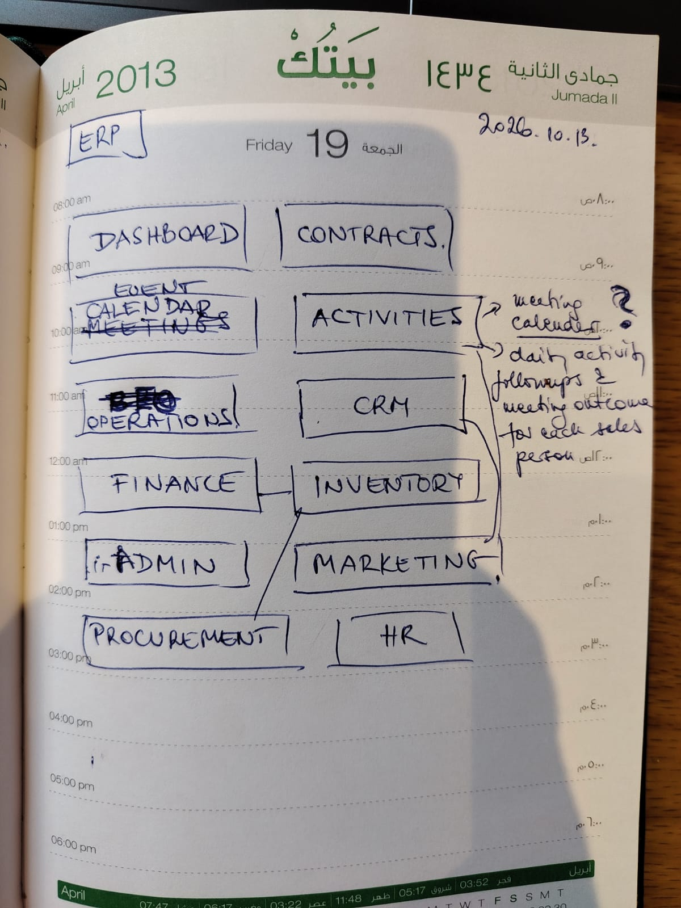
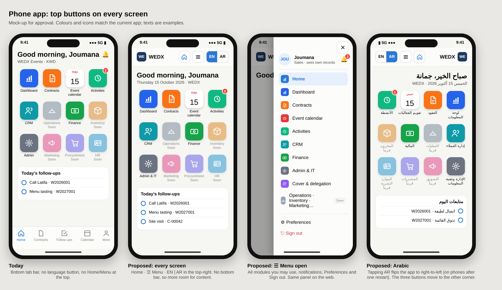

# SaaSERP — all discussions

_Built 2026-10-18 by `npm run discussions` from the discussion folders. Don't edit this file by hand: edit the folder's `discussion.md` and run the script again._

## Index

| # | Date | Topic | Status |
|---|---|---|---|
| [01](#discussion-01) | 2026-09-30 | Platform build through the CRM database (transcript sections 1–36) | Done |
| [02](#discussion-02) | 2026-10-16 | Continue development locally: UI (Tailwind, shadcn, 21st.dev, motion), WEDX templates, company identity | Open |

---

<a id="discussion-01"></a>

## Discussion 01 — Platform build through the CRM database (transcript sections 1–36)

2026-09-30 · Done · folder [01_2026-09-30_platform-build-to-crm-database](01_2026-09-30_platform-build-to-crm-database/)

- **Started:** 2026-09-30 · **Ended:** 2026-10-16 · **Status:** Done
- **Full record:** [docs/session-transcript.md](../docs/session-transcript.md) (sections 1–36). It is kept where it is; this file only indexes it.

### What was built

Multi-tenant API and web app, Docker and Hostinger deployment, workspace approvals and dashboard, team hierarchy,
cover and transfer, iOS/Android app, English/Arabic, full export, Phase 1 and 1b of the customer's module plan,
contract documents from Word templates, and the CRM database (C + 10 digit IDs, duplicate check, relationships,
applicant profiles, employee IDs, CRM workbook import/export). Last commit: `aaa5a5a`.

### Open items carried into discussion 02

- Update the live server (`git pull --ff-only`, rebuild with the production overlay), then import the CRM workbook and re-upload the WEDX contract template.
- Re-import Melinda's new workbook; check who sees finance figures.
- Try Phase 1b on the server.
- Next phase (Operations): short design for approval before development — see [docs/MODULES.md](../docs/MODULES.md#next-phases).
- Optional: automatic server updates; Hostinger connector.

### Outputs / scripts

None in this folder; deliverables of this discussion are in the repository code and `docs/`.

### Full record: docs/session-transcript.md

Session dates: 30 Sep – 15 Oct 2026
Repository: `AlaaOpsAi/SaaSERP`, branch `claude/affectionate-sagan-hru2m7`

This file reproduces what was shown on screen during the session: your messages, my replies, and the progress notes I posted while working. Raw command output and code listings are left out; the code is in the repository.


#### Open items (as of 14 Oct 2026)

- [ ] **Update the live server** (section 26): `git pull --ff-only`, then rebuild with the production overlay. After that, check that https://app.opsaibridge.eu shows the icon home screen and that https://trackerapp.opsaibridge.eu (GoalPace) is still up.
- [ ] **Re-import Melinda's new workbook** (Admin → Import from Excel) so existing contracts get Branch, Design and split client names (section 23).
- [ ] **Check who sees the finance figures:** sales and viewers no longer see them by default. Re-enable under Admin → Contract fields if needed (section 23).
- [ ] **Optional:** automatic server updates, so new versions go live without manual commands (section 24).
- [ ] **Optional:** connect the Hostinger connector, then start a new session to manage the VPS from here (sections 15–17).
- [ ] **Try Phase 1b** after updating the server: Plan / Log / Report under Activities, Admin → IT, Admin → Deactivated records.
- [ ] **Next phase** (Operations): a short design for approval before development starts ([MODULES.md](../docs/MODULES.md#next-phases)).

---

#### 1. Request

> **You:** i need to build ERP system like Oracle's OPERA Cloud Sales & Event Management module
> - What is the actual product scope you're targeting? **Events & catering sales platform (Recommended)**
> - Who is going to pay for this? **Multi-tenant SaaS for other companies**
> - you can use attached sheet for reference *(REPORT_Daily - NEW.xlsx)*

##### Progress notes during the build

- The repository was empty. I read the reference spreadsheet.
- **What the workbook contains:**
  - **`CONTRACTS`** is the event pipeline. Each row goes from enquiry → meetings → follow-up → DEF/TEN/LOS/CXL and carries revenue, cost, margin, a 20% fixed cost, a 20% credit-facility cost, net profit, commission, two partner shares, client outstanding and aging.
  - **`PAR`** holds the lookup lists: event types, sources, account managers, venues, statuses, currencies and bank accounts.
- Postgres 16 and npm were available in the build environment. The plan:
  - **Stack:** a TypeScript monorepo. `apps/api` is Fastify + PostgreSQL; `apps/web` is React + Vite.
  - **Multi-tenancy:** shared database with `tenant_id` on every row, enforced by Postgres Row-Level Security. The app uses a restricted role and migrations use the owner role.
  - **Domain (OPERA S&E-style):** bookings with the INQ/TEN/DEF/ACT/LOS/CXL lifecycle, events in function spaces, a function diary with conflict checks, activities, revenue/cost lines, payments, commissions and partner shares, plus the sheet's margin, fixed-cost, credit-facility and aging formulas.
  - **Import** of the existing workbook so tenants can migrate from Excel.
- **Importer test on your real workbook:**
  - 102 contracts, 97 clients and 40 venues, with no errors.
  - The conversion rate matches the sheet's header (2 DEF of 102, about 2%).
  - Re-importing updates the rows instead of duplicating them.
- **Tests:** 16 API integration tests pass. They cover tenant isolation at the database level, numbering, the finance formulas, the status workflow, room-conflict checks, reports and the import.
- **Fixes from the first screenshots:**
  - Login reached the API, but the UI stayed on the login page because `qc.clear()` detached the auth observer. Fixed.
  - The sheet's HALL column holds free text such as "arraya or grand hyatt". The importer now creates rooms only for real holds (TEN/DEF/ACT).
  - The diary got an "only rooms in use" filter.
  - The revenue chart got an empty state, and "Lost" bars changed from aqua to neutral gray.
- **End-to-end browser test:** created a booking, added a priced line, confirmed it and recorded a payment.
  - 120 pax × 15 = 1,800 revenue and 720 margin.
  - 20% fixed cost leaves a net profit of 576.
  - 800 still outstanding after a 1,000 payment.
- **Time-zone bug:** events showed in the browser's zone (3:00 PM in a UTC browser) instead of the workspace's (6:00 PM in Asia/Kuwait). All times now follow the workspace time zone; checked in UTC and New York browsers.
- **Production packaging:** the API serves the built web app, so the whole product ships as one container.

##### Reply

I've built a first working version of the events & catering sales platform, set up as multi-tenant SaaS, and pushed it to `claude/affectionate-sagan-hru2m7`. All 16 API tests pass, and I ran the full sales flow in a real browser. The Docker image is written but untested, because this environment has no Docker.

**What's in it:**
- **Bookings:** each enquiry moves through Inquiry → Tentative → Definite → Actualised, or ends as Lost or Cancelled with a required reason.
  - Booking numbers follow your sheet's format (`W2026001`), counted per company code and year.
  - Every status change is kept in a history.
- **Function diary:** rooms across all venues, day by day. A confirmed booking can't take a room that another confirmed booking already holds; managers can override. Tentative clashes are flagged in red.
- **Profit per booking:** uses your sheet's formulas. Revenue minus cost gives gross margin; the 20% fixed cost and the 20% credit-facility cost come off that; commission and partner shares come from what's left. Each workspace can change the percentages.
- **Payments:** client payments with outstanding balance and aging, and commission and partner shares tracked as paid or to pay.
- **Follow-ups:** meetings, calls and follow-ups, which keep each booking's last and next follow-up dates current.
- **Clients:** contacts and companies with their booking history.
- **Dashboard:** conversion, win rate, revenue, margin, pipeline, lead sources, lost reasons and account-manager performance.
- **Excel import and export:** import your workbook, and export a sheet laid out like your `CONTRACTS` sheet.
- **SaaS basics:** companies sign up for their own workspace; there are six roles (owner, admin, manager, sales, finance, viewer); plans limit the number of users; currency and time zone are set per company.

**Tested with your workbook:** it imported 102 contracts, 97 clients and 40 venues with no errors. The conversion rate matches your sheet's header (2 confirmed of 102, about 2%). Re-importing updates the existing rows instead of duplicating them.

**Keeping companies' data apart:** the database itself only shows each company its own rows, so a missed filter in the code still can't leak data between companies. The tests check this.

**Things to know about your data:**
- The two confirmed contracts in the sheet have no revenue or cost filled in, so money figures show 0 until you add lines or amounts.
- A few values look like typos, for example an enquiry date in 2028.
- Lost reasons are free text ("poor followup", "low budget"…) and are imported as written. Mapping them onto the standard list would make the lost-reasons chart cleaner.
- `.gitignore` excludes `*.xlsx`, so your workbook, which has client phone numbers, was not committed.

To try it: `npm run db:seed` creates a demo workspace (log in with `owner@demo.test` / `demo12345`). Setup steps are in `README.md`. How each sheet column maps into the system is in `docs/EXCEL-MAPPING.md`.

**Not built yet:** quote and contract PDFs, a menu and package catalogue, banquet event orders (the operations sheet per event), deposit schedules and invoices, subscription billing, and an Arabic right-to-left interface. They're listed in suggested order in `docs/ROADMAP.md`. I'd suggest proposals and contracts next, since they close the loop from Tentative to Definite.

*(Screenshots sent: the dashboard on your imported workbook, a booking after the test flow, and the function diary in dark mode.)*

---

#### 2. "so what's next ?"

My recommendation is to put the system in front of your sales team before adding more features. Then build in this order:

**1. Deploy it for your own team first (about a day)**
- Put it on a real server with a managed Postgres database, a domain and HTTPS. You have a Hostinger account connected, so I can check whether your plan can run a Node.js app.
- Import the latest daily report and have the account managers log every new enquiry in the system for 2–3 weeks instead of in Excel.
- Their feedback will show which gaps actually matter before we build for other companies.

**2. Proposals & contracts (the biggest gap)**
- A quote or contract made from a booking, as a PDF with your branding, that you send by WhatsApp or email.
- The client accepts it by e-signature, and the booking moves to Definite automatically.
- Today the system tracks a deal but can't produce the document that wins it.

**3. Menu & package catalogue**
- Saved priced packages, such as "Wedding buffet 250 pax" or "Kosha set A", that you add to a booking in one click instead of typing lines.
- This also gets revenue and cost filled in on every booking. In your current sheet even the confirmed deals have no revenue entered, which is why the dashboard shows 0.

**4. Deposits & payment schedules**
- Due dates for deposit and balance, reminders and invoice numbers.
- These feed the outstanding and aging figures, so receivables can be chased.

**5. Selling it to other companies**
- Online subscription billing, an admin console for you as the operator, and an Arabic right-to-left interface.
- Only worth doing once your own team is happy with steps 1–4.

To move faster I need two decisions from you:
1. **Where to host:** Hostinger, or a cloud host like Render, Railway or AWS?
2. **Who signs up first:** your company only for now, or a pilot customer already lined up? This decides whether subscription billing (step 5) moves earlier.

If you'd like, I can start on step 2 (proposals & contracts) now while you decide on hosting. I can also open a pull request for what's on the branch so far.

---

#### 3. "how to Deploy it on my Macbook i have docker installed"

##### Progress notes

- I couldn't test the Docker setup earlier (no Docker in this environment), so I checked it for problems that would only appear on a Mac.
- The lockfile already includes the Linux ARM64 builds of every native tool, which Docker on an Apple-silicon Mac needs. I switched the image from Alpine to Debian-slim to avoid musl edge cases.
- From a clean clone I replayed both Dockerfile build stages, then started the app on a brand-new Postgres instance initialised the way the `postgres:16` container is. Migrations ran, the web app was served, and sign-up worked.
- **Fixes:**
  - Removed the database's `5432` port mapping so it can't clash with a Postgres already installed on the Mac.
  - `JWT_SECRET` and `APP_PORT` are now read from `.env`.
  - Containers restart automatically.

##### Reply

Here's how to run it on your MacBook. I replayed every Docker step here except Docker itself (there's no Docker in this environment): both build stages from a clean copy of the code, and the startup on a brand-new database. Migrations ran, the app came up and sign-up worked.

**1. Make sure Docker Desktop is running** (whale icon in the menu bar).

**2. Download the code and start it.** In Terminal:

```bash
git clone https://github.com/AlaaOpsAi/SaaSERP.git
cd SaaSERP
git checkout claude/affectionate-sagan-hru2m7
echo "JWT_SECRET=$(openssl rand -hex 32)" > .env
docker compose up -d --build
```

The first build takes about 3–5 minutes. After that, starting it takes seconds.

**3. Open http://localhost:4000**
1. Click **Create a workspace**, enter your company and your login, and use **W** as the booking prefix to match your sheet.
2. Go to **Settings → Import from Excel** and upload `REPORT_Daily - NEW.xlsx`.
3. Go to **Settings → Team** to add your account managers with their initials (JOU, LOJ, MEL…) and give them logins. The importer already created them as account managers without a login, so give those existing users an email and password rather than adding new ones.

**Day-to-day commands** (run them inside the `SaaSERP` folder):

| Task | Command |
|---|---|
| See logs | `docker compose logs -f app` |
| Stop | `docker compose down` (your data is kept) |
| Start again | `docker compose up -d` |
| Get my updates | `git pull && docker compose up -d --build` |
| Back up the data | `docker compose exec db pg_dump -U postgres saaserp > backup.sql` |
| Delete everything | `docker compose down -v` ⚠️ erases all data |

**If something goes wrong:**
- **Port 4000 is already in use:** add `APP_PORT=8080` to the `.env` file and open http://localhost:8080 instead.
- **Your team wants to use it from other computers on your office network:** they open `http://<your-Mac's-IP>:4000`. You can find the IP under System Settings → Wi-Fi → Details. It only works while your Mac is awake and Docker is running.

I made the setup more Mac-friendly and pushed it to the same branch:
- **Debian-based images** instead of Alpine, to avoid problems with native packages on Apple-silicon Macs.
- **The database no longer uses your Mac's port 5432.** If you already run Postgres locally, it won't clash.
- **Your login-signing key now comes from `.env`**, not a value fixed in the code.
- **Containers restart automatically** after a reboot.

Running it on your MacBook is fine for testing and a small pilot. For your team to rely on it every day, the next step is a small cloud server with automatic backups.

---

#### 4. Save the screen output to a Markdown file

> **You:** can you extract all current screen output to md file

> *(Then a stop-hook notice: "There are untracked files in the repository. Please commit and push these changes to the remote branch.")*

##### Reply

I saved this conversation as a Markdown file: `docs/session-transcript.md`.

It has your three requests, my replies (including the full Mac deployment steps and command table), the progress notes I posted while working, and the list of commits. I left out raw command output and code listings because the code is already in the repository. The screenshots aren't embedded; they're only mentioned where I sent them.

The file isn't committed yet, so it's only in this session's copy of the project. To get it into your MacBook's copy, I can commit and push it to the branch.

I committed `docs/session-transcript.md` and pushed it to `claude/affectionate-sagan-hru2m7` (commit `13b67c7`). It was the only uncommitted file, so the working tree is now clean. On your MacBook, run `git pull` in the `SaaSERP` folder to get it.

---

#### 5. Workspace approval workflow and a more interactive dashboard

> **You:** now what i need from you to create an approval workflow to accept new workspace plus please enhance the dashboard page make it more fancy and interactive

##### Progress notes

- I'll build both. Plan:

  - **Approval workflow:** new sign-ups wait as **Pending**, and you (the platform operator) approve, reject or suspend them from a separate operator console.
  - **Dashboard:** comparison with last year, drill-down clicks, switchable charts and a sales funnel.

  First I'll re-read the interaction guidance for the charts.
- The chart guidance is loaded. Starting with the backend for the approval workflow: a migration that adds a status to each workspace and a table of platform operators, kept separate from tenant users.
- Typecheck passes. Postgres stopped when the environment restarted, so I'll start it again.
- Migration applied. Next I'll update the test helper so new workspaces are approved through the operator API, and add tests for the approval workflow.
- Seed works. Now the dashboard API: last-year comparison, a sales-rep filter, drill-down keys, a stage pipeline with values, and top deals.
- One existing test fails as expected: lost reasons now include a `code` for drill-down. I'll update that assertion and add coverage for the new comparison and filter.
- The backend is done, with 21 tests passing. Now the web side, starting with sign-up, login and the API client.
- Now the operator console: a separate login, plus a review queue with approve, reject, suspend, reactivate and plan controls.
- Now I'll wire the console into routing and add its styles, then rebuild the dashboard.
- Now the dashboard page itself.
- Before screenshots, I'll give the demo workspace about 18 months of realistic history. With only 6 bookings, the comparisons and trends have nothing to show.
- Two things to check: the drill-down counted 0 rows (possibly measured before the list loaded), and the phone layout overflows horizontally. First the screenshots.
- Stretching the sparkline would squash its end dot into an ellipse, so I'll let it scale proportionally instead.
- The drill-down now returns all 8 bookings. The phone layout still overflows somewhere, so I'll find the element that's too wide.
- It's 3px of overflow: the metric toggle's row is slightly wider than the card on small screens.
- No more page overflow on phones. The one button still past the edge sits inside the metric toggle, which scrolls sideways on small screens. Checking the updated views.
- Both themes look right now. Next, the approval flow end to end in the browser: request a workspace, try to sign in while it's pending, approve it in the operator console, then sign in.
- Everything works in the browser. Last step: documentation and Docker settings, including how to create your operator account on the Mac. Then a full check and push.

##### Reply

Both features are built and pushed to `claude/affectionate-sagan-hru2m7`. All 21 API tests pass (5 of them new, for approval), and I ran both features end to end in a real browser.

###### Workspace approval

- **Requesting:** a new company now fills in a request form, which also asks for a phone number and a note about their business. They see a "request received" page, and signing in tells them the workspace is waiting for approval.
- **Your operator console** at **`/platform`** is separate from any company's login. It shows the waiting requests with owner, email, phone, note and when they asked. From there you:
  - **Approve:** choose their plan and how many users they can have.
  - **Reject:** a reason is required, and the customer sees it when they try to sign in.
  - **Suspend / reactivate:** suspending signs the company's users out immediately. Their data is kept.
  - **Change plan** for an active company.
  - Each decision records who made it and when.
- **Notifications:** if you set `SIGNUP_WEBHOOK_URL` to a Slack or Teams incoming-webhook address, you get a message for each new request. There is no email notification yet.
- To skip review, for example on a demo server, set `AUTO_APPROVE_SIGNUPS=true`.

###### Dashboard

- **Filters:** year (with ‹ › arrows), business unit and account manager. Every number on the page follows them.
- **Headline:** confirmed revenue for the year with the change versus last year, plus a running-total line comparing this year with last year.
- **Attention cards:** overdue follow-ups, money clients still owe you, and open pipeline.
- **Six KPI tiles**, each showing the change versus last year:
  - Bookings, gross margin and net profit also show a small 12-month trend line.
  - Lost bookings counts a rise as bad, in red.
- **Monthly performance:** switch between revenue, gross margin, net profit and booking counts, always against last year. Hovering a month shows both years; there's also a table view.
- **Breakdowns:** pipeline by stage, lead sources with the share won, why you lose, a team leaderboard, top deals, and events in the next 30 days.
- **Click anything** to open the matching bookings, for example "March", "Instagram" or "lost: budget too low". The bookings page shows these as filter chips you can remove.
- It works in light and dark mode and at phone width.

###### Updating your Mac

```bash
cd SaaSERP
git pull
docker compose up -d --build
docker compose exec app node apps/api/dist/scripts/create-platform-admin.js you@company.com 'a-long-password' "Your Name"
```

Then open http://localhost:4000/platform and sign in with that operator account. Your existing workspace stays active; only new sign-ups wait for approval. The full workflow is described in `docs/APPROVALS.md`.

The demo data now includes 18 months of sample bookings and one pending request, so you can try both features straight away. Running the seed (`npm run db:seed`) is only for the local, non-Docker setup.

---

#### 6. Operator account and password

> **You:** what's the operator account. and password

##### Reply

Your Docker setup has **no operator account yet**. You create it yourself, with your own email and password, by running this once on your Mac inside the `SaaSERP` folder:

```bash
docker compose exec app node apps/api/dist/scripts/create-platform-admin.js you@yourcompany.com 'YourStrongPassword' "Your Name"
```

For example:

```bash
docker compose exec app node apps/api/dist/scripts/create-platform-admin.js alaa.hamouda@opsaibridge.com 'Choose-A-Long-Password-1' "Alaa Hamouda"
```

When it prints `Platform admin … is ready`, open **http://localhost:4000/platform/login** and sign in with that email and password.

- The password must be at least 10 characters. Keep the single quotes around it if it contains symbols like `!` or `$`.
- **Forgot it?** Run the same command again with the same email and a new password; it resets it.
- **More operators:** run the command with a different email for each person.
- **It's not your company login:** your operator account only manages workspaces, and your company login is still the one you use for bookings.

**The demo account doesn't exist in Docker.** The pair I mentioned earlier (`admin@platform.test` / `platform12345`) is only created by the demo seed in the local non-Docker setup. Don't use it on anything real.

---

#### 7. Error when activating a user

> **You:** i tried to change 1 user to be active while i recieved error A record with the same unique value already exists

##### Progress notes

- That message comes from the database's uniqueness rules for users. Within one workspace, no two users can share the same **email**, and no two can share the same **initials code** (JOU, LOJ…). So the user you edited is being given an email or code that another user already has. That most often happens with account managers created by the Excel import: if you'd already added a separate login user for the same person, they now clash.

  The generic message doesn't say which field or which user, which is a bug on my side. I'll fix that, and also check the related save path for other gaps.
- Now a test that reproduces your exact situation, then the fixes.
- Typecheck passes. I'll restart the API to load the change, then click through your scenario in the browser.
- The web dev server had stopped too; restarting it.
- The fix works in the browser. Committing and pushing.

##### Reply

I've fixed this and pushed it. The error meant the user you were activating was being given an **email or initials code that another user in your workspace already has**. Each must be unique within a workspace.

**Why it happens:** your Excel import created account managers by initials only (JOU, LOJ, MEL…), with no login. If you had also added the same person as a new login user, there are now two users for one person. Giving the imported one that person's email clashes with the login user.

**What changed:**
- **Clear message:** for example, "Joumana (JOU) already uses the email jou@… If they are the same person, merge the two users."
- **One-click merge** in that same dialog. It moves all of the duplicate's bookings, follow-ups, clients and commissions to the user you keep, then removes the duplicate. It keeps whichever user can sign in, and never removes your own account.
- **Manual merge:** every user's edit dialog now has **"Duplicate of another user? Merge…"** for cleaning up duplicates yourself.
- **Two gaps closed:**
  - Activating a user now respects your plan's limit on login users. Before, editing skipped that check.
  - Giving someone a login now requires a password. Before, you could activate them without one, and they couldn't sign in.

I tested your exact case in the browser: the message names the other user, and the merge leaves one user who owns all the bookings and can sign in. The API now has 24 passing tests.

**On your Mac:**
```bash
cd SaaSERP
git pull
docker compose up -d --build
```
Then go to **Settings → Team**, edit the user again and click **Save**. When the message appears, click **Merge … into …**.

If you'd rather not update yet, you can work around it today: edit the *other* user that already has that email, clear or change their email, save, then activate the one you wanted. Their bookings stay split between the two users until you update and merge.

---

#### 8. Three or four levels of reporting hierarchy

> **You:** could you please consider 3 or 4 levels of hierarchy so the manager can see all records under his sub managers and each manager can see all direct mangers and sub employees or account managers

##### Progress notes

- Here's the design.

  **Hierarchy**
  - Each user gets a **"Reports to"** manager. Depth is unlimited, so 3–4 levels work: Director → Sales manager → Team lead → Account manager.
  - **Visibility runs downward:** a manager sees their own records plus everything owned by anyone below them, at every level. Account managers at the bottom see only their own.
  - **Scope per user:** "Whole company" or "Their team". Owners and admins always see everything, and finance defaults to whole company.

  **What's covered**
  - Bookings plus everything inside them (events, lines, payments, commissions, history), activities, the dashboard, finance reports and the Excel export.
  - **Clients stay shared** company-wide, so two teams don't create the same client twice.

  **Function diary**
  - Rooms booked by other teams still appear, but only as anonymous "Booked" blocks.
  - Double-booking checks still run against the whole company.

  **How it's enforced:** by the database, the same way companies are kept apart, so a missed filter in the code still can't show another team's data.
- Now the server side. Every request loads the user's scope and team, and the database applies it.
- Migration applied and typecheck is clean. A quick look at the diary route after the edit.
- The existing 24 tests still pass with team visibility switched on. Now a test of a real 4-level hierarchy with two separate branches.
- Now the dropdowns, diary and clash messages.
- The org chart and the edit dialog work. The "Can see" option text gets cut off, so I'll shorten it. Then docs, the full checks and the push.

##### Reply

I've added the reporting hierarchy and pushed it. Managers now see their own records plus everything owned by anyone below them, at every level; account managers see only their own. All 30 tests pass, 6 of them new for the hierarchy. In the browser, each level showed the right totals:

| Signed in as | Position | Bookings they see |
|---|---|---|
| Owner | top | 69 (everything) |
| Melinda | Sales manager (level 2) | 45 = her own + Lojain's + Joumana's |
| Lojain | Team lead (level 3) | 34 = her own + Joumana's |
| Joumana | Account manager (level 4) | 23 (her own only) |
| Ahmad | another branch | 24 (his own + Ghada's), none of Melinda's |

**How to set it up:** go to **Settings → Team** and edit each person.
- **Reports to:** their manager. Any depth works: Director → Manager → Team lead → Account manager. Loops are refused.
- **Can see:**
  - **Their team:** own records plus everyone below them.
  - **Whole company:** everything.
  - Owners and admins always see the whole company.
  - New users default by role: finance sees everything; managers and sales see their team.
- **Org chart view:** the Team page now draws the tree, and each card says what that person can see.

**What's limited:**
- **Bookings** and everything inside them: events, revenue lines, payments, commissions, history, follow-ups.
- **Reports:** the dashboard, finance receivables and payouts, and the Excel export.
- **Assigning:** dropdowns only list your team, and you can't assign a booking to someone outside your team.

**What stays shared:**
- **Clients** (contacts and companies) are visible to everyone, so two teams don't create the same client twice.
- **Function diary:** you still see every occupied room. Rooms booked by other teams show as hatched **"Booked · Another team"** blocks, without the client or link.
- **Room clash checks** still cover the whole company. If another team has the ballroom, you can't double-book it, and the message just says "Another team's booking".

**The database enforces it**, the same way companies are kept apart, so a missed filter in the code still can't show another team's records.

**On your Mac:** run `git pull && docker compose up -d --build`. Your existing users **keep seeing the whole company** until you set each one's "Reports to" and change "Can see" to "Their team", so nothing changes until you've built the tree. Details are in `docs/HIERARCHY.md`.

---

#### 9. Delegation

> **You:** what about delegate ? shall we add delegate ?

##### Reply

Yes, I'd add it. With the hierarchy in place, the first problem you'll hit is an account manager going on leave. Today their bookings disappear from their colleagues' view, so nobody can answer that client's follow-up unless a manager steps in.

###### What I'd build

**Delegation:** "Joumana gives Ghada access to her records from 10 to 20 October."

- **Who sets it up:** the person themselves, their manager, or an admin.
- **Period:** a start and end date. Access switches on and off automatically, so nobody has to remember to remove it.
- **Access level:**
  - **View & act:** Ghada can see Joumana's bookings, log follow-ups and update them. This is the default.
  - **View only.**
- **What it covers:** Joumana's own records. As an option, also everyone below Joumana, which suits a manager covering for another manager.
- **Follow-ups:** an optional "hand over my open follow-ups" moves Joumana's open activities to Ghada for the period.
- **Clear trail:** anything Ghada changes records "Ghada on behalf of Joumana" in the booking history. A banner in the app says whose records she's covering.
- **Permanent use:** no end date means a standing delegation, for example a sales coordinator who supports two managers.

**Transfer** is the other case, for when someone **leaves**: move all of their bookings, follow-ups and clients to another person in one step. It's a different action from delegation, and you'll likely need it too.

###### How it fits

This plugs straight into what's built. A user's "team" for visibility would become their own team plus whatever is currently delegated to them, still enforced by the database. Nothing else in the app needs to change.

###### Decisions

1. **Default access:** "view & act" (my recommendation) or "view only"?
2. **Can a delegate approve commissions or record payments** for the person they cover? I'd say **no**; those stay with finance and managers.
3. **Can account managers delegate on their own**, or must a manager or admin approve it? I'd let them do it themselves and notify their manager.
4. **Build "transfer on leaving" now too?**

If my recommendations suit you (view & act; no money actions; self-service with a manager notification; transfer included), say **go** and I'll build both.

---

#### 10. "go": build delegation and transfer

> **You:** go

##### Progress notes

- Building both:
  - **Delegation:** view & act by default; delegates can't take money actions; self-service, with the manager notified.
  - **Transfer:** for someone who's leaving.

  First, the database.
- Now the request scope: it adds each user's active delegations, separates "can read" from "can change", and works out "on behalf of" for the audit trail.
- I'll put the write checks and audit logging in a small shared module, then route every booking change through it.
- The existing tests still pass with the guards in place. Next, activities: covered follow-ups appear in the delegate's own list, and completing one records who did it on whose behalf.
- Next, the delegation, notification and transfer endpoints.
- That "covering" column was half-finished: it was being passed an empty team list. The screen can work it out from your own team list, so I'll take it out.
- Typecheck and tests pass. Now the screens. First, where booking detail checks permissions.
- Next: the "Cover & delegation" page, the notification bell, the banner shown while covering, the activities tags, and the transfer dialog.
- Typecheck is clean. Last screen piece: a **Transfer…** button on the Team page for admins and managers, next to each person in their team.
- Joumana's sign-in didn't reach the dashboard. Checking the API directly.
- The API is fine (sign-in and profile both return 200), so the page itself must be failing. Capturing the browser error.
- The profile response is missing the new cover fields, so either the edit didn't apply or an old API process is still serving.
- `ss` isn't installed here, so my restart loop never stopped anything: the old API kept serving and the new one couldn't take the port. I'll stop the old processes by PID instead.
- The new API is serving. I'll also make the screen tolerate an older API that doesn't send the cover fields, so it can't crash like that again. Then I'll rerun the story.
- That's expected: Lojain opened the bell on the previous run, so her notification is already marked read. I'll make that step tolerate a read notification.
- The payment button is correctly hidden for Ghada. My script read the wrong table for history (it picked up the profitability card), so I'll check the screenshot instead.
- Exactly right: Ghada's edit is logged as "Ghada, on behalf of Joumana", both cover notices show, and the money buttons are gone. Checking the transfer dialog.
- Both screens look right. Next: documentation, the full checks, then commit and push.

##### Reply

I've added cover/delegation and transfer, with the defaults you agreed, and pushed them. All 36 tests pass, 6 of them new.

I also ran it in the browser with the demo team:
1. Joumana arranged cover by Ghada until 10 Oct.
2. Joumana's manager, Lojain, got a bell notification: "Joumana is covered by Ghada (1 Oct – 10 Oct)".
3. Ghada saw a banner and Joumana's bookings in her lists, and changed the number of guests on one.
4. The booking's History tab shows that change as **"Ghada, on behalf of Joumana"**.
5. The payment and commission buttons were hidden for Ghada.

###### Cover & delegation (new menu item)

- **Who can set it up:** account managers for themselves; managers for anyone in their team; admins for anyone.
- **Dates:** "from" and "until". Access starts and stops by itself. Leave "until" empty for a standing arrangement, such as a coordinator who supports two managers.
- **View & act** (default) or **view only**. View only is enforced by the database, not just hidden on screen.
- **Options:** cover the person's whole team (for managers), and hand over their open follow-ups.
- **Money stays put:** the person covering can't record payments or commissions, even if their role normally allows it.
- **Clear trail:** every change on a booking is now logged with who did it, and "on behalf of" whom while covering. The booking's History tab shows it.
- **Notification bell:** the person covering, the person covered and their manager are told when cover is set up, changed or ended. Banners remind both people while it's active.

###### Transfer (someone leaves)

**Settings → Team → Transfer…** is for managers (within their team) and admins. In one step it moves the person's open bookings (or all), open follow-ups, companies and direct reports to a colleague. It also deactivates the person: they're signed out at once and any cover involving them ends. Closed history and commissions they already earned stay with them.

###### What to know

- A bug in my local restart script meant my in-browser checks for the previous update might have run against an older API process. The automated tests aren't affected by that and passed. This time I restarted properly and re-ran everything in the browser.
- One small robustness fix came out of this: the screen no longer crashes if it ever talks to an older API.

**On your Mac:** `git pull && docker compose up -d --build`. The details are in `docs/HIERARCHY.md`.

---

#### 11. Mobile app for iOS and Android

> **You:** can you build mobile app as well work on IOS and android

##### Progress notes

- Yes. I'll build it with **Expo (React Native)**: one TypeScript codebase that produces both the iOS and Android apps and uses the API you already run.

  I can't run an iPhone simulator or Android emulator in this environment. I can typecheck the app, export its web build, and drive that in a browser at phone size. You can then run it on your own phone in a few minutes with the free **Expo Go** app.

  Checking what's available first.
- Expo SDK 57 is current, and that's what Expo Go on phones supports. Creating the project, kept separate from the web workspace so their React versions can't clash.
- The template ships guidance warning that Expo changes every release and says to read the current docs rather than rely on memory. I'll follow it.
- Packages are installed. Now I'm checking expo-router's exact current API (entry point, routes folder, tabs and stack components) from its own files before writing screens.
- Two notes from the package itself: `Tabs` from the main `expo-router` import is deprecated in favour of `expo-router/js-tabs`. I'm also checking how it finds the routes folder.
- The routes folder can be `src/app`, which is what the template's guidance recommends. Now I'm wiring up the app's config and core: server address, secure token storage, theme and API client.
- Now the core library: the API client (talks to your server, keeps the login token in the phone's secure storage), sign-in state, formatting and theme.
- Next: sign-in state and shared UI pieces (cards, badges, buttons, fields, chips, list rows).
- I'm confirming the last navigation imports from the package, then writing the screens.
- Next: the shared booking and follow-up rows, then the Home and Bookings tabs.
- Next: the **new enquiry** form (built for capturing a lead mid-call), plus the Follow-ups, Diary, More and Notifications screens.
- Typecheck is clean. I'll confirm it's really checking the new screens, then build the web version to test in a browser.
- The app itself works; the sign-in request got a 500 from the API. Checking the server log.
- Postgres stopped again when the environment idled; restarting it and re-running.
- Home and booking detail look right: cover banner, KPIs with last-year change, one-tap Call/WhatsApp, and status buttons. A quick look at the bookings list.
- That's the template's setting to enable the official Expo plugin for Claude Code in this folder. It's harmless and useful later, so I'll keep it.

##### Reply

I've built the mobile app for iOS and Android and pushed it to the branch, in `apps/mobile`. It's one TypeScript codebase (Expo, React Native) that uses your existing API, so the same logins, team visibility and cover rules apply automatically.

I couldn't run an iPhone or Android simulator here. Instead I built the app's web version and drove it in a browser at iPhone size, signed in as Ghada while she covers Joumana. Every screen worked with no errors:
- sign in
- the Home dashboard
- booking search and filters
- a booking with Call/WhatsApp
- adding a follow-up
- follow-ups, diary and More tabs
- saving a new enquiry

Typecheck is clean. On a real phone it may still need small visual adjustments.

###### What's in the app

| Screen | What the salesperson gets |
|---|---|
| **Home** | Revenue, conversion, pipeline and money outstanding, compared with last year; today's follow-ups to tick off; events in the next 30 days; notification bell; cover banner |
| **Bookings** | Search by name, client, phone or booking number; Open / Definite / Lost / All; **+ New enquiry** |
| **Booking** | **Call / WhatsApp / Email** the client in one tap; change status (Lost asks for the reason); event and money summary; add a follow-up with quick times ("tomorrow 10 am"); tick follow-ups done; history |
| **New enquiry** | Capture a lead in under a minute, mid-call |
| **Follow-ups** | Today / Overdue / All open / Done, with one-tap done |
| **Diary** | Day by day: which rooms are booked and any clashes |
| **More** | Profile, notifications, cover in force, sign out |

It follows the phone's light/dark mode, and the login is stored in the phone's secure storage. Admin work (settings, Excel import, approvals, setting up cover) stays in the web app.

###### Try it on your phone today

1. Install **Expo Go** from the App Store or Google Play.
2. On your Mac, with the Docker app running:
   ```bash
   cd SaaSERP && git pull
   cd apps/mobile && npm install && npx expo start
   ```
3. Scan the QR code: iPhone Camera app, or Expo Go on Android.
4. On the sign-in screen, set **Server address** to your Mac's Wi-Fi address, for example `http://192.168.1.20:4000`. Find it under System Settings → Wi-Fi → Details. Then sign in as usual.

###### Publishing to the App Store and Google Play

Builds run in Expo's cloud, so you don't need Xcode or Android Studio. The commands are in `docs/MOBILE.md`. You'll need:
- An **Apple Developer** account ($99/year) and a **Google Play** developer account ($25 once).
- Your own app ID in `app.json`, replacing `com.saaserp.sales`, and your own icons.
- The API on a public **HTTPS** address instead of your Mac. Store apps shouldn't use plain-HTTP servers, and it also means your team won't have to type an address.

That last point makes moving the server off your Mac and onto a hosted server the next step before a store release.

---

#### 12. Languages, look and feel, full export, database documentation and backups

> **You:** great effort thank you , i have some requirements
> first can we make it multi language (English ,Arabic and other can be added )
> second give the end user to change  the look and feel (theme , color )
> third for the admin can give him option to export full data not only contract but lookup and others like user and user permission
> last can  we have full documentation  including data ERD tables ,views ,functions and the propose for each object
> finally how can we access the database and take database backup

##### Progress notes

- That's five pieces of work. Here's how I'll approach each before starting:

  1. **Languages:** English and Arabic (with right-to-left layout) on web and mobile, built so adding another language means dropping in one file. Each user picks their language. Pick-list values like event types and lost reasons get translations too.
  2. **Look & feel:** each user chooses light/dark/system mode, an accent colour, density and text size. The admin can also set a company brand colour as the default for everyone.
  3. **Full export for admins:** one Excel workbook (a sheet per table) and a JSON file with everything: bookings and their contents, clients, pick-lists, venues, users, roles, permissions, the reporting tree and cover arrangements. Password hashes are never included.
  4. **Documentation:** I'll write a description of every table, column, view and function into the database itself. A script then generates `docs/DATABASE.md` with the ERD diagram, so the documentation can't drift from the real schema.
  5. **Database access & backups:** a safe way to connect with a database tool, plus backup and restore scripts, automatic daily backups, and a guide.

  Starting with the database: listing every object that needs a description.
- That's 22 tables, 2 views and 15 functions. Migration 005 adds the language and appearance settings and describes every object inside the database.
- New workspaces should also get the Arabic pick-list labels from day one. Updating the sign-up defaults, then migrating.
- Typecheck is clean. Next, tests for preferences, branding, translations and the export, including a check that no password hash ever appears in it.
- One correction before running it: GitHub keeps underscores in heading anchors, so the table links mustn't swap them for dashes.
- The column lists came back as raw text (Postgres `name[]` isn't parsed by the driver). Casting them to text.
- The browser automation package was cleared from the scratch folder; reinstalling it.
- First the translation module itself: language list, the `t()` function, right-to-left handling, and number/date formats per language.
- Before the automated pass, I'll check for existing variables named `t` that would clash with the translation function.
- A few clashes (Charts, Dashboard, Diary, Settings). Renaming those local variables first.
- My script named a function `process`, which hid Node's own `process`. It failed before touching any file; renaming and re-running.
- 493 unique strings were wrapped and the app still typechecks. I'll review the list for anything that's actually a code value rather than visible text.
- The pass skipped template strings (text with values inside, like "`{n} open · {m} lost`"), which need placeholders. Listing them.
- I'll convert all of these to translated text with placeholders, and switch status names, month names and pick-list labels to the active language.
- That one line didn't exist in this form, so the script stopped without changing the file. Re-running the Settings changes without it, plus the pick-list names and the transfer dialog title.
- Typecheck is clean. Now I'll collect every translation key in the web app, both the wrapped strings and the label lists translated at render time, as input for the Arabic dictionary.
- Every key has an Arabic translation. Writing `ar.ts` for the web app.
- The Arabic dictionary covers 555 strings. Next, the appearance system and the right-to-left layout. I'll find every left/right-specific style that must mirror in Arabic.
- Typecheck is clean. I'll re-scan for any strings added since the dictionary was built (Preferences page, Settings, colour names) and translate them.
- Now add the translations and regenerate ar.ts.
- Finishing the Arabic translations for a few missed button labels, then mobile, docs, tests and push.
- Web Arabic is complete; now adding the same language and theme support to the mobile app.
- Rename conflicting `t` variables, then add the mobile i18n module and run the codemod.
- Running the translation codemod over the mobile screens now.
- Now the strings the codemod can't catch (screen titles, alerts, template text).
- Now mobile appearance (theme + accent from the user's preferences).
- Now the language/appearance picker in the More tab.
- Now the mobile Arabic dictionary — built from the web map plus mobile-only phrases.
- Now the mobile-only Arabic phrases.
- Mobile done. Now the docs (I18N guide + README).
- Docs written. Updating the README backup line, then running tests and a browser check.
- Tests pass (39/39), typecheck and build are clean. Now a browser check of Arabic, theme and the Export tab.
- RTL, dark theme and purple accent render correctly. The download didn't fire — checking why.
- The selector matched the "Import from Excel" tab. I'll fix the selector, and also delay revoking the object URL, which some browsers need.
- The export works and has no password column. Quick look at the Arabic dashboard and booking screenshots.
- Three things are still in English on the booking page: the status buttons, "Cost" and "Partner shares". Finding them.
- Translations complete on web (565/565) and mobile. Final touch: make checkboxes and sliders follow the accent, then commit.

##### Reply

All five items are done and pushed to `claude/affectionate-sagan-hru2m7`. The 39 API tests pass, and the web and mobile apps typecheck and build. I checked Arabic, dark mode, the accent colours and the Excel export in a browser.

###### 1. Multi-language (English and Arabic, more can be added)
- **Web and phone app are both translated.** In Arabic the whole layout flips to right-to-left and dates use Arabic month names. Numbers stay as 0–9 so amounts are easy to read.
- **Choosing a language:**
  - Each user picks theirs under **Preferences** (web) or **More → Language & appearance** (phone). The choice follows them to every device.
  - Admins set the company default under **Settings → Company**.
  - The sign-in page has its own language switch.
- **Pick-lists** (event types, sources, lost reasons…) are company data, so admins translate them under **Settings → Lists**. Each extra language gets its own column there.
- **On phones**, switching to or from Arabic asks the user to restart the app once so the layout can flip.
- **Adding a language** (e.g. French) means copying the Arabic dictionary file, translating it and adding one line to the language list. `node scripts/i18n-check.mjs` lists any text still untranslated. The steps are in `docs/I18N.md`.

###### 2. Look and feel
Under **Preferences** each user sets:
- **Theme:** light, dark, or match the device.
- **Accent colour:** 9 presets or any custom colour.
- **Density and text size.**

Admins can set a **company brand colour**, which is everyone's default until they pick their own. Chart and status colours never change, so figures read the same for everyone. Theme and accent also apply in the phone app.

###### 3. Full data export (admins)
**Settings → Export** downloads the whole workspace as Excel (one sheet per table, plus a README sheet) or as JSON. It includes:
- bookings with their finance figures, events and lines, payments, commissions, activities and history
- clients, venues and rooms
- pick-lists with their translations
- users with their roles and reporting lines, cover arrangements, and a permissions matrix

Passwords are never included, and workspace owners get a notification every time someone exports.

###### 4. Documentation — `docs/DATABASE.md`
- **ER diagrams:** three of them, covering people and access, setup and clients, and sales.
- **Every object:** each table and column, both views, every function, every access rule and every database role, with what it's for.
- **Purpose descriptions** are also stored inside the database itself, so tools like pgAdmin or DBeaver show them.
- **Regenerate it** after schema changes with `npm run docs:db -w apps/api`.

###### 5. Database access and backups — `docs/OPERATIONS.md`
**Connect** from TablePlus, DBeaver, Excel or Power BI:

| Setting | Value |
|---|---|
| Host / port | `127.0.0.1` / `5433` |
| Database | `saaserp` |
| User / password | `saaserp_readonly` / `saaserp_readonly` |

This login sees every workspace's data but cannot change anything. The database only accepts connections from your own Mac, not the network. To open it in pgAdmin in a browser, run `docker compose --profile tools up -d pgadmin` and go to http://localhost:5050.

**Backups:**
- A `backup` service takes one automatically every day into `./backups` and keeps 14 days.
- Take one now with `./scripts/backup.sh`.
- Restore with `./scripts/restore.sh backups/<file>.dump`. It asks you to confirm, takes a safety backup of the current data first, then restores.
- Copy the `backups` folder off the Mac (iCloud, Drive or similar) so you have a copy if the machine fails.

**Before you use it on your existing Docker setup:**
1. Run `git pull && docker compose up -d --build`.
2. The read-only login is only created on a fresh install, so create it once:
   ```bash
   docker compose exec db psql -U postgres -c "CREATE ROLE saaserp_readonly LOGIN PASSWORD 'saaserp_readonly' BYPASSRLS;"
   docker compose restart app
   ```
3. Change the default database passwords before putting this on a real server.

---

#### 13. Language picked on the sign-in page was not kept

> **You:** after i change the language on login screen this not affect the application language

##### Progress notes

- Testing it in the browser — pick Arabic on the sign-in page, sign in, then sign out and back in.
- All three cases now behave as expected. Updating the doc and pushing.

##### Reply

I've fixed it: the language you pick on the sign-in page now stays after you sign in, and the fix is pushed.

**Cause:** after sign-in, the app looked at your account's saved language and then the company's default language. Every company has a default (English unless an admin changes it), so your choice on the sign-in page was always replaced.

**Fix:** a language picked on the sign-in or sign-up page now counts as your own choice. When you sign in, it's saved to your account, so it also applies on your other devices. You can still change it later under **Preferences**.

I tested it in the browser:
- **Pick Arabic, then sign in:** the app opens in Arabic, right-to-left ("مساء الخير، Alaa").
- **Sign in from another browser:** it's still Arabic, because the choice is now on the account.
- **Pick English, then sign in:** the app switches back to English.

To get the fix on your Mac, run `git pull && docker compose up -d --build`.

---

#### 14. Update this transcript

> **You:** could you update session-transcript.md with all new discussion

##### Reply

This file was extended with every request since the first version (sections 4 onward), with the same layout: your message, my progress notes and my final reply.

---

#### 15. Check Hostinger to deploy

> **You:** could you check my Hostinger  to deploy this application

##### Progress notes

- The database logins currently use fixed default passwords. That's acceptable on a laptop, but not on an internet server, so I'll make them configurable from `.env`.
- The role script works, including a password with a quote in it. Now the step-by-step Hostinger guide.
- Checking that the backup/restore scripts still work when the server overlay is in use.
- No Docker in this environment, so I'll at least validate both compose files as YAML (including the `!override` tag) before committing.

##### Reply

I couldn't check your Hostinger account: the Hostinger connector isn't connected to this session. Connect it at https://claude.ai/customize/connectors, then start a new session, because connectors are only picked up when a session starts. After that I can look at which plan you have, your domains and your servers.

In the meantime I've prepared the server deployment and pushed it to the branch. There's no Docker here, so it hasn't been run. The script that creates the database logins was tested against a real Postgres, and the compose files were checked as valid YAML.

**Which Hostinger plan you need:** a **VPS** (KVM 1 for a pilot, KVM 2 recommended). The app needs Docker and PostgreSQL, which Shared, Cloud and WordPress hosting don't offer. If you only have one of those, add a VPS; your domain can stay where it is.

**What I added:**
- **HTTPS on your own domain** (`docker-compose.prod.yml` and `deploy/Caddyfile`). A web proxy called Caddy gets a free certificate and renews it automatically, and the app itself is no longer reachable directly from the internet.
- **Server preparation script** (`deploy/server-setup.sh`). It installs Docker if it's missing, opens only SSH and web ports in the firewall, turns on automatic security updates and adds swap memory so the build doesn't run out of RAM.
- **Database passwords now come from `.env`** instead of the fixed defaults, which weren't safe on an internet-facing server. Your Mac setup keeps working as it is.
- **Step-by-step guide** in `docs/DEPLOY-HOSTINGER.md`. It covers choosing the plan, the DNS record, secrets, starting the app, moving your Mac data across, updates, keeping backups off the server, and a security checklist.

**The short version once you have the VPS:**
1. In hPanel's DNS settings, add an **A record**, for example `app.yourdomain.com`, pointing to the VPS IP.
2. On the server:
   ```bash
   ssh root@<VPS-IP>
   git clone https://github.com/AlaaOpsAi/SaaSERP.git && cd SaaSERP
   git checkout claude/affectionate-sagan-hru2m7
   bash deploy/server-setup.sh
   ```
   The repository is private, so `git clone` will ask you to sign in with your GitHub username and an access token.
3. Create `.env` with your domain and randomly generated passwords; the guide has a copy-paste block for this.
4. Start it:
   ```bash
   docker compose -f docker-compose.yml -f docker-compose.prod.yml up -d --build
   ```
5. Open https://app.yourdomain.com and create your operator account. In the phone app, set the server address to that `https://` address.

If you've turned on the firewall in hPanel, also allow ports 80 and 443 there, otherwise the certificate can't be issued. Nightly backups stay on the VPS itself, so also turn on Hostinger's VPS snapshots or copy the backups folder to your Mac now and then.

---

#### 16. Check access to Hostinger

> **You:** check your access to hostinger

##### Reply

I still don't have access to Hostinger. No Hostinger tools are available in this session, and the connector still shows as needing sign-in.

This session can't pick it up, even if you've connected it since: connectors are only loaded when a session starts. To give me access:

1. Go to https://claude.ai/customize/connectors, find **Hostinger**, and click **Connect** (or reconnect it if it shows an error).
2. Start a **new session** on this repository, branch `claude/affectionate-sagan-hru2m7`. Everything is pushed, so nothing from this session is lost.
3. Ask there: "check my Hostinger and deploy SaaSERP using docs/DEPLOY-HOSTINGER.md".

In that session I can see your plan, VPS, IP and domains, and tell you what's missing (for example whether you have a VPS or only shared hosting).

If you'd rather not connect it, the guide in `docs/DEPLOY-HOSTINGER.md` works without it. You can also send me what hPanel shows under **VPS** and **Domains** (plan name, IP, domain), and I'll give you the exact commands and DNS record.

---

#### 17. Check again

> **You:** check again

##### Reply

I checked again. Your Hostinger connector is now connected on your claude.ai account and enabled for chats, so that part is fixed.

This session still can't use it. Its tools never loaded, because the connector wasn't authorized when the session started, and connectors are only picked up at session start. There's no way to reload it from inside this session.

To get Hostinger access:
1. Start a **new session** on this repository, using branch `claude/affectionate-sagan-hru2m7`. Everything is pushed, so nothing is lost.
2. In that session, ask: "check my Hostinger and deploy SaaSERP using docs/DEPLOY-HOSTINGER.md".

In that new session I can see your plans, VPS, IP and domains, check whether you have a VPS (shared hosting can't run this app), and go through the guide step by step.

---

#### 18. Customer comments are coming

> **You:** dear i will start add some comments from the customer which we need to apply on the exiting app or refactor the app based on your  recommendations so please wait i will add comments plus photos then will ask you once finish to give me your recommendations after i approve your recommendations you can start develop or redevelop the app i will use below sentence  "i finished my comments please provide your recommendations "  after you receive please provide your recommendations

##### Reply

Understood. Send the customer's comments and photos whenever you're ready. Until you write **"i finished my comments please provide your recommendations"**, I'll only read and note each comment, and won't change any code.

Once you send that sentence, I'll reply with recommendations: what each comment means for the current app, whether it's a small change, a redesign or a new feature, a suggested order, and any questions I have. I'll start development only after you approve them.

Some things that make the comments easier to act on:
- **Photos:** screenshots of the current app, the customer's own screens or Excel sheets, or sketches. Add a line saying which screen each one is about.
- **Priority:** if the customer said something is a must-have or a nice-to-have, mention it.
- **Language:** Arabic or English are both fine.

---

#### 19. Customer comment 1: module icons (photo)



> **You:** [10:21 AM, 10/13/2026] melindamo: Here is the ICON list for the modules we gonna build
> [10:21 AM, 10/13/2026] melindamo: It is not complete yet, i ll add more soon
> [10:22 AM, 10/13/2026] melindamo: The order /sequence of the icons is not final yet
> [10:22 AM, 10/13/2026] melindamo: I want it to look like the iPhone icons
>
> *(photo: hand-drawn module sketch dated 2026.10.13 — Dashboard, Contracts, Event Calendar, Activities, Operations, CRM, Finance, Inventory, Admin, Marketing, Procurement, HR; notes beside Activities: "meeting calendar?", "daily activity, followups & meeting outcome for each sales person")*

##### Reply

Comment #1 is noted. I'm only noting it for now and won't change anything yet. Here's what I read from the sketch, dated 2026-10-13:

**Modules on the home screen, as iPhone-style icons** (order not final):

| Left column | Right column |
|---|---|
| Dashboard | Contracts |
| Event Calendar (crossed out: Calendar / Meetings) | Activities |
| Operations (crossed out: BEO) | CRM |
| Finance | Inventory |
| Admin | Marketing |
| Procurement | HR |

**Notes beside Activities:**
- "Meeting calendar ?" with a question mark, which is still open.
- "Daily activity, follow-ups & meeting outcome for each sales person."

**Lines between modules:**
- Finance ↔ Inventory
- Inventory ↔ Procurement
- Activities / CRM ↔ Marketing

**From Melinda's messages:**
- The list isn't complete yet; more icons will be added.
- The order of the icons isn't final.
- It should look like the iPhone home screen.

Please check one thing for me: is "BEO" the crossed-out word under Operations (Banquet Event Order)? It's hard to read, and it changes what the Operations module would cover.

Send the next comments when you're ready. When you write **"i finished my comments please provide your recommendations"**, I'll come back with recommendations covering all of them.

---

#### 20. Customer comment 2: opening page and Contracts

> **You:** [10:24 AM, 10/13/2026] melindamo: It will be our System opening Page
> [10:24 AM, 10/13/2026] melindamo: Welcome message can go above the icons
> [10:24 AM, 10/13/2026] melindamo: As it is now
> [10:25 AM, 10/13/2026] melindamo: Each icon will have a picture or design, just like iPhone icons
> [10:27 AM, 10/13/2026] melindamo: CONTRACTS
>
> this is where each sales person registers the new leads, or new Bookings

##### Reply

I've noted comment #2 and haven't changed anything.

**Opening page:**
- The icon grid becomes the system's opening page, the first screen after sign-in.
- The welcome message stays above the icons, as it is now (the "Good morning, Name" greeting).
- Each icon gets its own picture or design, like iPhone app icons.

**Contracts:**
- This is where each salesperson registers new leads and new bookings.

The current **Bookings** screen already covers leads and bookings, so Contracts would be that module under the customer's name.

I'm ready for the next comments.

---

#### 21. Customer comment 3: grouping, the new workbook and hidden columns

> **You:** [11:02 AM, 10/13/2026] melindamo: for GROUPING
> [11:03 AM, 10/13/2026] melindamo: I am sending you the latest version of the Excel file we are using currently for the Data Entry
>
> *(attached the workbook "REPORT_Daily - NEW (1).xlsx")*
>
> [11:06 AM, 10/13/2026] melindamo: Some columns are hidden, for a reason
> [11:06 AM, 10/13/2026] melindamo: the hidden columns are not used by the sales team
> [11:08 AM, 10/13/2026] melindamo: The hidden columns are Finance related, and should be automatically getting the data from the Finance & Accounting
> [11:08 AM, 10/13/2026] melindamo: GROUPPING
> [11:08 AM, 10/13/2026] melindamo: Group 1.  Contract details
> [11:09 AM, 10/13/2026] melindamo: Group 2.  Followup Details
> [11:09 AM, 10/13/2026] melindamo: Group 3.  Client Details
> [11:10 AM, 10/13/2026] melindamo: We can add a separate Group for Payment Details (after Contract details)., if it makes sense.  Or the payment details can be part of the contract details
> [11:12 AM, 10/13/2026] melindamo: Maybe better to leave it as part of the contract details group, it is good to see all details in one page, related to contract and payment

##### Progress notes

- The file arrived. I'll read it and compare it with the earlier version of the workbook, so I can note what changed.
- I'll compare this with the version the app was built from.
- She mentions hidden columns, so I'll check exactly which ones are hidden in the new file.

##### Reply

I've noted comment #3 and haven't changed anything. Here's what I took from the new workbook and Melinda's messages.

####### The new workbook (the version used for data entry today)
- Still two sheets, **CONTRACTS** and **PAR**. It has 121 bookings so far, all under company **W**, branch **RB**:

  | Status | Bookings |
  |---|---|
  | Lost (LOS) | 76 |
  | Tentative (TEN) | 38 |
  | Cancelled (CXL) | 3 |
  | Confirmed (DEF) | 3 |

- **Changed since the version the app was built from:**

  | What | Change |
  |---|---|
  | **Branch** | New column. PAR now lists branches like RB = Radisson, SY = Symphony, PI = Park Inn |
  | **Hotel location** | Replaces "loc" |
  | **Hall area** | Replaces "Hall" |
  | **Payment** | "Money received (DP)" and "Diff ctrl" replace "Diff" |
  | **Credit facility** | The column is now called "CF" |
  | **Client name** | Now split into **first name / contact** and **family name** |
  | **Instagram ID** | "Alias # / Insta ID" replaces "saved serial" |
  | **Address** | "Address details" replaces "address details / area" |
  | **CAT column** | Removed |
  | **PAR** | Gains **Branch**, **Hotel location** (41 hotels) and **Design** (WX1–WX150) lists |

- **Effect on the app:** the current Excel import expects the old layout, so it will need updating. I'll cover that in the recommendations.

####### Hidden columns
- **30 columns are hidden** and the sales team doesn't use them:
  - revenue, cost, gross margin and margin %
  - fixed cost, CF cost, net profit
  - commission and the two partner shares, with their paid status and dates
  - fully-paid date, client outstanding and aging
- They're **finance figures, and should fill in automatically from Finance & Accounting**, not be typed by sales.

####### Grouping of the booking screen (for the sales team)
**Group 1: Contract details, with payment details on the same page**, as Melinda preferred:
- contract ID, company, branch, status
- event date, hotel location, hall area
- pax/units, rate, term/days
- total contract value, money received (down payment), difference, credit facility

**Group 2: Follow-up details:**
- request description and notes
- enquiry date
- last follow-up date and client feedback
- lost reason
- meetings 1–5, each with date, time, location and notes

**Group 3: Client details:**
- country/nationality, Instagram ID
- first name, family name
- phone, email, address

####### Questions to settle before the recommendations
You can answer them now or with your next comments.
1. **Source and Account manager (AM):** which group do they belong in? They sit between the contract and follow-up columns, so I'd put them in Contract details unless Melinda prefers otherwise.
2. **Design codes (WX1–WX150):** PAR has this new list, but no CONTRACTS column uses it. What is it for, and where should it appear?

The workbook contains customer names and phone numbers, so I'm only reading it here. I won't add it to the repository.

I'm ready for the next comments.

---

#### 22. Recommendations

> **You:** i finished my comments please provide your recommendations

##### Reply

###### Recommendations

**In short:** keep the current app and build on it; it doesn't need a rebuild. Most of what Melinda described already exists under different names, and it needs regrouping more than redeveloping. The five modules that don't exist yet (Operations, Inventory, Procurement, Marketing, HR) are each the size of the current app, so I recommend building them one phase at a time rather than all at once.

####### 1. Opening page: iPhone-style icon home screen
- **The page:**
  - The welcome message stays at the top, as it is now.
  - Below it, a grid of rounded-square icons, each with its own drawn design and colour.
  - Icons are about 6 per row on desktop and 4 on phones.
  - The same home screen goes into the mobile app.
- **Modules not built yet** still appear, greyed out with a "Coming soon" badge. Melinda sees the whole roadmap from day one, and nothing gets moved later.
- **Order:** since the order isn't final, admins can drag icons to rearrange them for the whole company.
- **Visibility by role:** each person sees only the icons their role allows. Sales doesn't see Admin, for example.
- **Navigation:** inside a module, the side menu stays, with a home button to return to the icon screen.
- **Icon artwork:** I'll design a consistent set myself. If Melinda has a designer, their artwork can replace mine later without other changes.

**Where each icon points:**

| Icon | Today | Work needed |
|---|---|---|
| Dashboard | exists | none |
| Contracts | the **Bookings** screen | rename, regroup (see 2) |
| Event Calendar | the **Function diary** | rename, add meetings (see 3) |
| Activities | exists | add the daily report (see 3) |
| CRM | **Clients** | rename |
| Finance | partly (money owed, commissions) | grows in a later phase |
| Admin | **Settings** | rename |
| Operations, Inventory, Procurement, Marketing, HR | don't exist | "Coming soon", built in later phases |

####### 2. Contracts: one page in three groups, as Melinda described
- **Layout:** one scrolling page with three titled sections and quick-jump links at the top, so everything is visible on one page.
  1. **Contract & payment details:**
     - contract ID, company, **branch**, status
     - event date, **hotel location**, hall area
     - pax/units, rate, term days
     - total contract value, **money received (down payment)**, difference (calculated automatically), credit facility
     - source and account manager
  2. **Follow-up details:**
     - request and notes, enquiry date
     - last follow-up and client feedback, lost reason
     - **meetings**
  3. **Client details:**
     - **first name**, **family name**, phone, email
     - nationality, **Instagram ID**, address
- **Meetings:** instead of copying the sheet's fixed 5 meeting slots, each meeting becomes an activity with date, time, location, notes and **outcome**, with no limit on the number. They show as a timeline in the follow-up group and also feed the meeting calendar and daily report. The 5 meeting columns in the Excel import become meetings automatically.
- **Hidden finance columns:**
  - They disappear from the sales view and calculate automatically:
    - revenue, cost, margin
    - fixed and credit-facility costs, net profit
    - commission and the two partner shares
    - outstanding and aging
  - Finance and managers see them in a separate Finance panel on the same booking.
  - The figures come from what the Finance team enters (payments, costs, commission payouts), so sales never types them.
  - Full automatic posting from a Finance & Accounting module comes in Phase 3.
- **Excel import:** I'll update it to read this new workbook layout, while still accepting the old one. The new **Branch**, **Hotel location** and **Design** lists will load into the pick-lists.

####### 3. Activities and Event Calendar
- **Daily activity report per salesperson:** one screen per day showing each person's:
  - calls, meetings and follow-ups done
  - meeting outcomes
  - what's overdue

  Managers see their whole team on the same screen (the existing team visibility applies). It can be exported to Excel.
- **Meeting outcome required:** when a meeting is marked done, the salesperson must write the outcome. That's what makes the report useful.
- **"Meeting calendar ?":** I recommend **not** making it a separate icon. Instead, the **Event Calendar** gets a switch between events, meetings, or both, with day, week and month views. That's one calendar and one less icon.

####### 4. Order of work

| Phase | Content | Size |
|---|---|---|
| **1 (recommended now)** | Icon home screen (web and mobile); renames; Contracts regrouping with the new fields; finance columns hidden from sales; meetings with outcomes; daily activity report; meetings in the Event Calendar; updated Excel import | Medium |
| 2 | **Operations:** event orders for the operations team (the BEO idea) — menus, setup, timings, staffing per event | Large |
| 3 | **Finance & Accounting:** invoices, receipts, expenses (the PAR categories like rent, salary, gifts), bank accounts. This is what fills the hidden columns automatically | Large |
| 4 | **Procurement + Inventory together**, linked to Finance as in the sketch: suppliers, purchase orders, stock in and out | Large |
| 5 | **Marketing** (campaigns, lead-source return, Instagram leads into CRM), then **HR** | Large each |

Phases 3 and 4 make this a real ERP rather than a sales system. They're a bigger commitment, so before starting each one I'll come back with its own short design for approval.

####### 5. Questions to answer with your approval
1. **Branch vs Hotel location:** PAR has Branch "RB = Radisson" and also Hotel "RADISSON". Is Branch your own outlet (where your team works), and Hotel location the venue of the event?
2. **Design codes (WX1–WX150):** what are they, for example décor packages? Should Contracts have a Design field?
3. **Down payment:** can sales record the down payment themselves, with Finance confirming it? Or does only Finance enter money?
4. **Operations:** please confirm that the crossed-out word was "BEO" (Banquet Event Order).
5. **Source and account manager:** OK to put them in Contract details?

If you approve **Phase 1** and answer the questions, I'll start development. You can also change anything above, such as the order of the phases or which icons show as "Coming soon".

If you'd like to forward these recommendations to Melinda, I can also make them a shareable page.

---

#### 23. Answers to the questions: Phase 1 approved

> **You:** 1-yes our own outlet (where your team works), and Hotel location the venue of the event m2- i'm not sure but you can check where column "W" in Par sheet used on the contract sheet if you didn't find it consider it as dropdown list in contracts with the design field  ,3-sales can ecord the down payment themselves,  4- Operations ignore BEO word  ,5- Source and account manager you can keep it on contract details while has the flexibility  to hid based on the login user

##### Progress notes

- Thanks, that answers all five questions. I'll take this as approval of Phase 1 and start. First, checking where PAR column **W** (Design) is used in CONTRACTS.
- Reviewing the booking API before making changes (Phase 1 has started).
- Pick-list types are open-ended, so **Branch** and **Design** are just two new lists. Writing migration 006.
- Migration applied. Moving on to the API.
- Writing the field-visibility module.
- Now hooking it into the request context so every request knows which fields are hidden for its user.
- Now the booking routes: new fields, client name split, hiding, and down payments by sales.
- Same name handling for the CRM contacts API.
- Now the activities side: a meeting can't be marked done without an outcome, a type filter for the meetings calendar, and the daily activity report.
- The contracts Excel export also contains the finance columns, so it must respect hidden fields too.
- Now the daily activity report endpoint.
- Registering the route, then the admin settings (field visibility, icon order) and the profile response.
- API compiles. Now tests for the new behaviour. Checking the test helpers.
- Five of six pass. The failure comes from zod 4: a record keyed by an enum requires *every* role to be listed. A partial record fixes it.
- All 6 new tests pass. Updating the permissions matrix in the full export (sales can now record down payments), then running the whole suite.
- The admin's "who sees which fields" settings also count as permissions, so they belong in the full export.
- All 45 API tests pass. One check: the workspace sheet's query has to include the new column for that export to work.
- The API is done. Next, the Excel import for the new workbook layout.
- Compiles. I'll add a test that builds a workbook in the **new** layout: group row, headers in their new positions, branch, DP, split names and a meeting.
- Empty cells in the PAR header row leave holes in the array, so `startsWith` was called on `undefined`. Fixing that by filling the holes.
- The full API suite passes (46 tests). Now the web app, starting with the iPhone-style home screen.
- Writing the module list and icon artwork.
- Now the home page itself.
- Now the app shell: routes, menu names and a Home link.
- Typecheck is clean. Now the icon styling: rounded squares, the calendar face, the red badge, and the wiggle while arranging.
- Before moving on, a quick look at the home screen in the browser.
- It's an existing bug: on phones the layout grid stretches the top bar to fill spare height. One CSS line fixes it.
- Home screen done. Next is the contract page in three groups, the main piece of Melinda's feedback. Reading the current booking screen and form.
- Adding a small `useHidden()` helper, then rewriting the booking form in three groups.
- Now the "New contract" dialog has to send the client fields in the new shape.
- Now the main rewrite of the contract page. First, how the Activities page completes an activity, since both should share one "outcome" dialog.
- I'll write a shared "Mark done" dialog that requires the outcome for meetings and site visits.
- Now the contract page itself. I'll replace the Overview with the three groups and the edit dialog with one that saves client details too.
- Typecheck is clean. Two follow-ups on the Payments tab: label down payments as such, and hide the commission section from roles with finance hidden. Then the styles for the groups.
- The contracts list also shows money columns, so I'm checking what it displays to a role with finance hidden.
- Now the Admin side: a **Contract fields** tab where the admin ticks which roles see which fields, plus **Branch** and **Design** in the pick-lists.
- Task 5 is done. Next: the daily activity report and meetings in the Event Calendar.
- Adding a **Rooms / Meetings** switch to the Event Calendar. The meetings view is a week grid of everyone's meetings, filterable by salesperson.
- Now the daily activity report, as a second tab on the Activities page.
- Typecheck is clean. Before the browser check I need a salesperson login in the demo data, to verify what sales sees with finance hidden.
- The sign-in didn't reach the home screen. Checking the login directly.
- The web part of Phase 1 is done. I'm now adding the icon home screen and meeting outcomes to the mobile app.
- Writing the mobile pieces: types, the outcome sheet, and the module grid.
- Now the module icon grid on the mobile home screen. It uses the same 12 modules and the company's icon order. Modules that only exist on the web open the web app.
- Mobile is done and typechecks. Now the Arabic translations for every new screen and label.
- I'll also add labels that are translated at display time rather than written inline (module names, field names, tab names), since the checker can't see those.
- Arabic coverage is complete on web and mobile. Now the build checks, the regenerated database docs and an Arabic browser pass.
- Arabic works on the new screens. The only English left on the page is customer data (names, notes), and Joumana's sidebar no longer shows Finance or Admin. Now the documentation.
- All 46 API tests pass, both apps typecheck, the web build works, and no spreadsheet or database dump is in the change set. Committing and pushing.
- The push was rejected because the branch on GitHub has newer commits. Fetching them to see what changed.
- A simple conflict: they reworded one sentence on the mobile sign-in screen, and I added a line next to it. I'll keep their new wording plus my line.

##### Reply

I've built Phase 1 and pushed it to `claude/affectionate-sagan-hru2m7`. All 46 API tests pass, the web and mobile apps typecheck and build, and I clicked through every new screen in the browser as a salesperson, a manager and the owner, in English and Arabic.

Your answers are applied as follows:
- **Branch** is now a field on the contract (your own outlet) and **Hotel / location** is the event venue.
- **PAR column W (Design)** isn't used anywhere in the CONTRACTS sheet, so I added it as a dropdown on the contract.
- **Sales record the down payment** themselves.
- **Operations** has no "BEO" wording.
- **Source and Account manager** sit in Contract details, and the admin can hide them per role.

**What's new:**
- **Opening page:** the welcome line, then the modules as iPhone-style icons.
  - Event Calendar shows today's date like the iPhone Calendar icon. Activities shows a red badge with the follow-ups due.
  - Operations, Inventory, Marketing, Procurement and HR appear greyed out as "Soon".
  - The admin can rearrange the icons with **Arrange icons** (they wiggle like on the iPhone). The order applies to the whole company.
  - The phone app has the same icon grid.
- **Contracts:** one page in Melinda's three groups.
  1. **Contract & payment:** includes Branch, Design, total contract value, money received (DP), the difference, and a **Record down payment** button.
  2. **Follow-up:** request, dates, client feedback, and all meetings with their outcomes.
  3. **Client:** first name, family name, phone, email, nationality, Instagram, address.
  - The edit dialog uses the same three groups.
- **Hidden columns:** by default, salespeople and viewers no longer see the finance figures (revenue, cost, profit, commission and so on). The server removes them, so they also don't appear in the lists, the Excel export or the API.
  - Under **Admin → Contract fields** you can change this per role, including hiding Source or Account manager.
- **Activities:**
  - A meeting can't be marked done without writing its outcome.
  - A new **Daily report** tab shows, per salesperson per day: calls, meetings, follow-ups, what's overdue, contracts opened, won and lost, and each meeting's outcome. It downloads as Excel. Managers see their whole team; a salesperson sees only their own day.
- **Event Calendar:** a new **Meetings** view shows everyone's client meetings by day, with outcomes. Past meetings with no outcome are flagged in red.
- **Excel import:** it now reads columns by their header names, so both the old and the new workbook work. I tested Melinda's new workbook in the test database:
  - 120 contracts imported with no errors.
  - Money received totals 1,430 and the difference is −300, exactly matching the sheet's own totals row.
  - 11 branches and 150 designs loaded.
  - The workbook stays out of the repository because it contains client data.

**Things to know:**
- **Your live server isn't updated yet.** While I worked, two commits were added to the branch from elsewhere: a Hostinger post-install deploy script, and the mobile app now defaults to `https://app.opsaibridge.eu`. I merged them with my changes. To update the server, run this in the SaaSERP folder; the database changes apply automatically on start:
  ```bash
  git pull && docker compose -f docker-compose.yml -f docker-compose.prod.yml up -d --build
  ```
- **Salespeople will stop seeing profit figures** as soon as the server is updated. If any of them should keep seeing them, re-enable that under Admin → Contract fields.
- **To fill in Branch, Design and the split client names on existing contracts,** import Melinda's new workbook again under Admin → Import from Excel. Re-importing updates existing contracts rather than duplicating them.
- **Cover & delegation** isn't in Melinda's icon list, so it stays in the side menu only.

The details are in `docs/MODULES.md`, along with the proposed next phases: Operations, then Finance & Accounting, then Procurement with Inventory, then Marketing and HR. Each phase will come back to you as its own short design for approval before I start.

---

#### 24. Can you deploy it yourself?

> **You:** can you deploy it by yourself ?

##### Progress notes

- Before answering, I'll check how the server was set up, in case it updates itself from GitHub.

##### Reply

Not from this session. I have no way to reach your server from here:
- **The Hostinger connector isn't signed in for this session**, and it can't be signed in from inside a running session.
- **I don't have SSH access** (no key or password) to the server.
- **The server doesn't update itself.** I checked the deploy script used to install it: it clones the code and starts the app once, with no automatic pull from GitHub. https://app.opsaibridge.eu is up, but it's still running the earlier version.

**Fastest route: run it yourself, about 5 minutes, no software needed.**
1. In hPanel, go to **VPS → Manage → Browser terminal**. It opens a terminal on the server.
2. Paste:
   ```bash
   cd /root/SaaSERP
   ./scripts/backup.sh
   git pull
   docker compose -f docker-compose.yml -f docker-compose.prod.yml up -d --build
   ```
   That takes a backup first, then gets the new version and rebuilds. The database changes apply automatically on start, and existing data is kept.
3. Open https://app.opsaibridge.eu. After signing in you should see the icon home screen.

If `git pull` asks for a username and password, use your GitHub username and an access token, as in step 3 of `docs/DEPLOY-HOSTINGER.md`.

**For me to deploy:**
- **Connect Hostinger:** connect it at https://claude.ai/customize/connectors and start a new session, which picks up connectors when it starts. Its API can manage the VPS, but I'd first check whether it can run commands without reinstalling the operating system. The earlier deploy used a "post-install script", which only runs on a reinstall, and **a reinstall would erase your database**. I won't use that route.
- **Automatic updates:** I can add a small updater to the server that checks the branch every few minutes, takes a backup, and rebuilds when there's a new version. After that, every change I push goes live by itself. Setting it up needs one paste in the browser terminal, then nothing more from you. Say the word and I'll prepare it.

---

#### 25. Git "divergent branches" hint on the server

> **You:** i recived this hint "hint: You have divergent branches and need to specify how to reconcile them.
> hint: You can do so by running one of the following commands sometime before
> hint: your next pull:
> hint: 
> hint:   git config pull.rebase false  # merge
> hint:   git config pull.rebase true   # rebase
> hint:   git config pull.ff only       # fast-forward only
> hint: 
> hint: You can replace "git config" with "git config --global" to set a default
> hint: preference for all repositories. You can also pass --rebase, --no-rebase,
> hint: or --ff-only on the command line to override the configured default per
> hint: invocation."

##### Reply

The server's copy has a commit that isn't on GitHub, probably made on the server itself, so git won't merge on its own. The server should simply match GitHub. Your data is safe throughout: the database, `.env` and `backups/` aren't touched by git.

In the same browser terminal, first see what's different:

```bash
cd /root/SaaSERP
git fetch origin
git log --oneline origin/claude/affectionate-sagan-hru2m7..HEAD
git status --short
```

The `git log` line lists the commit(s) that exist only on the server. Then make the server match GitHub, keeping a copy of the server's version just in case:

```bash
git branch server-copy-$(date +%F)
git reset --hard origin/claude/affectionate-sagan-hru2m7
docker compose -f docker-compose.yml -f docker-compose.prod.yml up -d --build
```

- `git branch server-copy-…` saves the server's current version under a name, so nothing is lost.
- `git reset --hard` switches the code to exactly what's on GitHub. It only touches code files; `.env`, `backups/` and the database are left alone.
- The last line rebuilds and restarts the app. The database changes apply automatically.

Then open https://app.opsaibridge.eu; after signing in you should see the icon home screen.

If you paste me the output of the `git log` line, I'll tell you what that server-only commit was. If it was something worth keeping, I'll add it to the branch on GitHub so it isn't lost on the next update.

---

#### 26. The server-only commit (Caddy extra sites)

> **You:** below the output for the first one "59a04fa (HEAD -> claude/affectionate-sagan-hru2m7, origin/claude/laughing-galileo-ofjtzf) Caddy: serve extra sites from deploy/sites/*.caddy

##### Progress notes

- Good that we checked before resetting. That commit came from another work branch (`laughing-galileo-ofjtzf`) and changes how Caddy, the HTTPS server, works: it lets the server host **other websites** from `deploy/sites/*.caddy`. If you reset now, any other site on that VPS would go offline. Let me look at it.

##### Reply

Done. The branch on GitHub now contains everything: Phase 1, the live-server settings, and the server's Caddy change. Because the server's commit is now part of GitHub's history, the update is a plain fast-forward, with nothing to reconcile and nothing overwritten. GoalPace's site file stays as it is, since git doesn't track it.

In the browser terminal, run:

```bash
cd /root/SaaSERP
./scripts/backup.sh
git pull --ff-only
docker compose -f docker-compose.yml -f docker-compose.prod.yml up -d --build
```

Then check:
1. **https://app.opsaibridge.eu:** after signing in, you should see the icon home screen.
2. **https://trackerapp.opsaibridge.eu:** GoalPace should still be up as before.

If either page doesn't come up, paste me the output of:
```bash
docker compose -f docker-compose.yml -f docker-compose.prod.yml logs --tail 40 app caddy
```

---

#### 27. Keep the discussion in this file

> **You:** please keep the discussion here on md file so i can check it if i missed anything

##### Reply

This file was extended with sections 15 onward. From now on it is updated at the end of each request, so it always has the latest discussion.

---

#### 28. Customer comment 4: top buttons, activity module, Save/Cancel/Delete

> **You:** below more comments: Every page, every platform has to have 3 buttons in the right upper corner: HOME, MENU (3 lines only), LANGUAGE (EN | AR)
> Admin and IT will be under the same button
> New Company button to add on the Sign In platform
> ACTIVITY MODULE:
> - Each activity must be linked to either a CONTRACT ID (if client details are not yet available, but we got an enquiry before). Or CUSTOMER ID, if we approach this Client for the first time.
> - FUTURE ACTIVITIES: Planning the actions for next week - each action must be linked to a Client or a Contract ID
> - PRESENT ACTIVITIES: sales team and marketing team registers their daily activity in the system.
> - REPORT PRINTING: daily or monthly extract of each person's activity
> SAVE, CANCEL, DELETE buttons to be placed on each data entry page

##### Reply

Noted as comment #4; no code changes until "i finished my comments please provide your recommendations".

**Understood:**
1. Three buttons in the top-right of every page (web and mobile): Home, Menu (☰), Language (EN | AR).
2. Admin and IT under one button (the Admin icon).
3. A "New Company" button on the sign-in page.
4. Activity module:
   - every activity linked to a Contract ID or a Customer ID
   - future activities (next week's plan, each linked to a client or contract)
   - present activities recorded by the sales and marketing teams
   - daily or monthly printable report per person
5. Save, Cancel and Delete on every data entry page.

**Open questions:**
1. Should the ☰ Menu replace the left sidebar?
2. Is an automatic Customer ID like C-00001 fine?
3. Add a Marketing role with its own activity types?
4. Who may delete: salespeople (own entries) or only managers and admins?

---

#### 29. Answers on comment 4, and delete vs. deactivate

> **You:** 1- replace the left sidebar, 2 - ok, 3 yes please, 4 the challenge if sales add new contract and did mistake on it what shall he do delete or de-activate plus maybe managers and admins can do delete while it's better to be de-active so will not be available on any screen

##### Reply

**Answers noted:**
- The ☰ Menu replaces the left sidebar.
- Customer IDs will be like C-00001.
- A new Marketing role will be added.

**Recommendation for mistakes:**
- **Deactivate, don't delete.** A mistaken contract is marked "Deactivated (entered by mistake)" with a reason.
  - It disappears from every screen, list, calendar, dashboard, report and export.
  - It stays in the database with its history, and its number is never reused.
- **Different from Lost and Cancelled:** those are real outcomes and still count in reports. Deactivated counts nowhere.

| Action | Salesperson | Manager / Admin |
|---|---|---|
| Deactivate | own contracts, while Inquiry/Tentative and no payment | any contract |
| Restore | — | yes |
| Permanent delete | — | admins only, from the "Deactivated" list |

- For sales, the Delete button is labelled "Deactivate".
- Admins get a "Deactivated records" view.
- The same rule applies to clients and activities.

---

#### 30. Recommendations for comment 4 (Phase 1b)

> **You:** i finished my comments please provide your recommendations

##### Reply

**Phase 1b**, before Operations:

1. **Top bar on every page** (web and phone):
   - Home, ☰ Menu (all modules, Preferences, Sign out) and EN | AR, in the top-right.
   - The left sidebar is removed; the bell and the user's name move into the Menu.
   - The phone app gets the same three buttons; removing its bottom tab bar is recommended.
2. **Admin + IT:** a new IT tab in Admin showing the app version, the last backup time, and a sign-in and export log.
3. **New company button** on the sign-in page. Requests still need operator approval.
4. **Activity module:**
   - Every activity is linked to a Contract ID or a Customer ID (automatic C-00001 numbering), with search by name, phone or ID.
   - "Next week" plan per person, with carry-over; managers see their team's plans.
   - Quick "Log activity" for today's work, with outcome.
   - New Marketing role with types: campaign, social post, exhibition/event, advertisement, content.
   - Printable daily and monthly report per person (Print / Save as PDF), plus Excel.
5. **Save / Cancel / Delete (Deactivate) action bar** on every data entry page, with an unsaved-changes warning.
6. **Deactivate instead of delete:**
   - Enforced by the database, so deactivated records are hidden everywhere.
   - Sales can deactivate their own early-stage contracts; managers and admins can deactivate any and restore; admins can permanently delete from "Deactivated records".
   - The same applies to clients and activities.

**Questions:**
1. May marketing-only activities (social post, campaign) be saved without a client or contract? Recommended: yes, for marketing types only.
2. Leave existing unlinked activities as they are, in a "to link" list?
3. Remove the phone app's bottom tab bar?

---

#### 31. Approval of points 1–2; mock-up for point 3

> **You:** for point 1 and 2 i'm ok but for point 3 can you show me first what's expected screen?

##### Reply

**Points 1 and 2 approved:**
- Marketing-only activities may be saved without a client or contract.
- Existing unlinked activities stay as they are, in a "to link" list.

**Point 3 (phone app without the bottom tab bar):** mock-up for approval, showing today, the proposed screen, the ☰ Menu open, and Arabic.



---

#### 32. Approval and Phase 1b delivered

> **You:** approve

##### Reply

**Phase 1b is built and pushed.** 54 API tests pass, web and phone apps typecheck and build, Arabic is complete, and every screen was checked in a browser (web and phone width).

1. **Top bar on every page:**
   - Home · ☰ Menu · EN | AR. The left sidebar is gone.
   - The phone app has the same header and no bottom bar (as in the mock-up).
2. **Admin & IT:**
   - One icon. A new **IT** tab shows the version, database, last backup (with a 36-hour warning), and the sign-in and export log.
   - A new **Deactivated records** tab.
3. **New company** button on the sign-in page.
4. **Activities:**
   - **Customer ID** (C-00001) for every person and company.
   - Every client activity linked to a contract or customer ID.
   - **Marketing** role with campaigns, posts, exhibitions, ads and content.
   - **Plan** (next week, with carry-over), **Log activity** (with outcome), and **Report** (daily or monthly, Print / Save as PDF, Excel).
5. **Save / Cancel / Delete** on contract, client, company and activity forms, with a warning before discarding unsaved changes.
6. **Delete = Deactivate with a reason:**
   - Hidden everywhere by the database, and it frees the room.
   - Sales: own early-stage contracts only. Managers restore; admins delete for good, and only deactivated records.

**To update the server:** `git pull --ff-only`, then rebuild with the production overlay.

---

#### 33. Error when saving an activity (400 Bad Request)

**User:** "i got this error after delete activity log 'POST https://app.opsaibridge.eu/api/activities 400 (Bad Request)' … onSubmit …"

**Cause:**
- In **Log activity / Plan activity**, the "Contract or customer" box was filled with text (for example a name), but no result from the list was clicked.
- The browser accepted the typed text, so the form was sent **without a link**.
- The server correctly refused it with "Link the activity to a contract ID or a customer ID". That is the 400.
- Reproduced in the browser before fixing.

**Fix:**
- Typed text no longer counts as a link. Until a result is clicked, Save is blocked on the spot with "Choose a contract or customer from the list", and nothing is sent to the server.
- A hint under the box says "Click a result below to link it." It's in Arabic too.
- Checked in the browser: typed text alone → blocked, no request. Clicking a result → saved (200).
- The phone app was not affected: there, activities are always added from a contract.

**To update the server:** the same command as before (backup, `git pull --ff-only`, rebuild).

---

#### 34. Customer comment 5: signed contracts, issuing contracts and proposals, EN/AR templates

**User:** "some more requirements from the customer:
- 'Sales team needs to upload the Signed Contract to each DEF status Contract ID. Upload format: Picture JPEG, PNG, or PDF. Upload should work for all statuses. ???'
- 'Issuing CONTRACT / PROPOSAL from system: Contract template automatically fills from DATA entered for each Contract ID. From TEN or DEF status we can issue a contract or Proposal. Each Business Type has their own Template. Contracts may have Annexes (for example Wedding Specifications: full details for operations team). Client must sign it, approving all details.'
- 'CONTRACT / PROPOSAL templates: should they be available both in EN & AR version?'

…please check what's needed and provide your recommendation first"

**Recommendations given:**
1. **Signed contract upload:**
   - at every status (the answer to "???"), and required in practice at DEF
   - JPEG, PNG or PDF up to 15 MB, several files per contract
   - photo straight from the phone
   - asked for when the contract moves to DEF; flagged if skipped
2. **Issuing:**
   - the company's own Word templates with placeholders, per business type
   - from TEN or DEF; Word + PDF output
   - numbered, frozen copies; annexes as separate templates
   - the document shows Signed once the signed copy is uploaded
3. **EN & AR:** yes. Arabic, English or bilingual templates.
4. **Questions:** the list of business types; who issues; flag or block at DEF.

**User:** sent the files (`WEDX_Wedding_Contract_TOPRINT_OK.docx`, `W2025047_Qortuba_2025.10.09_SAMPLE.docx`, `Wedding_Details_Annex.docx`, `DB_CRM_Segm_1.2.xlsx`) and answered:
1. "go for what you think now"
2. "the salesperson"
3. "just be flagged"

**Delivered:**
- **Documents tab on every contract** (web) and a **Documents card** on the phone. Sections:
  - issued documents
  - uploaded files
  - **Services & prices** (printed in the contract)
  - **Annex details** (e.g. Wedding Specifications), with "Add the standard list for this business type"
- **Upload:**
  - JPEG, PNG or PDF, at every status; the type is checked from the content
  - on the phone: take a photo, choose a photo, or choose a PDF
  - links expire after 10 minutes
  - removing a file deactivates it
- **DEF:**
  - confirming asks for the signed copy at once
  - if skipped: "Not signed" in the contracts list, a **Signed contract missing** filter, and a warning on the contract and the dashboard
  - never blocked
- **Issue contract / proposal** (the salesperson, TEN or DEF):
  - fills the template with the contract's data, including the total in words in English and Arabic
  - makes Word + PDF and numbers it `W2026052-C1 / -P1 / -A1`
  - keeps the issued copy; it shows **Signed** when the signed copy is uploaded
- **Admin & IT → Templates:**
  - upload Word templates per business type, language (Arabic / English / both) and use (contract / proposal / annex); each upload is test-filled first
  - download the standard templates and see the placeholder list
  - annex checklist per business type
- **WEDX templates prepared from the customer's files:**
  - the blanks, the date, the `#` number box and the client's name in the trust receipt (إيصال أمانة) are filled automatically
  - the items table repeats per service
  - the civil ID and the signatures stay for writing by hand
  - the 31 wedding services became the annex checklist
- **Standard English & Arabic templates** come with the app for companies without their own.
- **Server:**
  - LibreOffice and fonts in the Docker image
  - files in `./uploads`, backed up nightly as `backups/uploads-<date>.tar.gz`
- **Checks:**
  - API tests: 54 → 58, all passing
  - checked in the browser (web and phone builds)
  - PDF conversion checked inside the production base image

**Not built yet:** `DB_CRM_Segm_1.2.xlsx` is a separate CRM database. It has segments, relations, customer IDs in the form `C000001`, and applicants. Recommendations for it follow separately.

**To update the server:** the usual command. The first build after this takes longer, because LibreOffice is added. Then, as an admin, upload the two WEDX templates and paste the wedding checklist under **Admin & IT → Templates**.

---

#### 35. Recommendations for the CRM database (DB_CRM_Segm_1.2.xlsx)

**User:** "can you share recommendations for DB_CRM_Segm_1.2.xlsx"

**What the workbook is:** the customer's master CRM layout.
- **DB:** 47 records, 56 columns. 29 applicants for the manpower contract X2025036, 9 suppliers, 4 clients and 4 partners.
- **PAR:** the pick-lists. 12 relation types, 35 segments, 32 industries, titles, contact consent, contact mode, users, education.
- **RULES:** the rules, partly in Hungarian.
- **CONTACT / COMPANY:** two empty draft layouts.

**Rules in the workbook:**
- One customer can have several business relationships. The email is unique per customer, and a duplicate gives a warning ("This email is already registered").
- The customer ID (CID) is automatic; the same email always gives the same CID; a CID needs at least one email.
- Companies and people both have IDs, and people are linked to their company.
- The serial must be 10 digits, not 7.
- The contract ID links a customer to the Contract module, only for customers who had an enquiry.
- The Excel extract keeps the same column order.
- Employee / user ID: E + hiring year + 4 digits (E20250001).

**Recommendations:**
1. **Customer ID:**
   - the automatic number becomes C + 10 digits (C0000000001), one series for people and companies
   - the existing C-00001 numbers are converted once (each customer keeps its place in the series)
2. **One customer, many relationships:** a Relationships list on every customer. Each relationship has:
   - a type (Client, Applicant, Supplier, Partner, Enquiry, Sales Blitz, Owner, Buyer, Seller, Employee, Attendee, LinkedIn)
   - a segment and industry
   - the date and who registered it (both automatic)
   - the linked contract ID, if any
   - comments

   The old Hungarian relation list (REL OLD) is not carried over.
3. **Duplicate check:**
   - the email is unique per company; typing an existing one warns and offers to open that customer
   - the same check for mobile numbers
   - the email-required rule: see question 2
4. **New customer fields:**
   - title, gender, position / profession
   - second mobile, landline, phones stored with the country code (+965 …)
   - city, ZIP, web page
   - company registration / licence number, tax ID, legal representative, parent company
   - date of birth or establishment, with age calculated
   - civil ID, which also fills رقم بطاقه مدنيه in the contract
   - newsletter consent (with the date given), preferred contact mode (Tel / WhatsApp / Email / Message / Any)
   - segment and industry as pick-lists under Admin → Pick-lists, filled from PAR

   The grey helper columns (EMAIL CTRL, CID ASSIST, CID COPY, REPETED CID, ALERT, AGE) are done by the system and not stored.
5. **Applicant data** (education, degree, experience, languages, driving licence, past employers):
   - personal recruitment data, so it goes in an Applicant profile on the customer
   - visible only to an HR role and managers, never to all sales
   - the HR module (Phase 5) builds on it later
6. **Employee ID:** an automatic E + hiring year + 4-digit number for each user, plus a hiring date under Admin → Team. The initials stay as the short code.
7. **Excel:**
   - CRM import reads this DB layout by its headers (like the contracts import): it skips the "end" rows, merges duplicates by email and lists names that need cleaning (e.g. "A B D U L A Z I Z")
   - CRM export writes the same 56 columns in the same order
8. **Privacy:**
   - marketing (newsletter, campaigns) uses only customers with consent YES
   - the workbook is never stored in the code; it is imported through the app

**Questions for the user / customer:**
1. Is C + 10 digits right (C0000000001), and should today's C-00001 numbers be converted?
2. Must every customer have an email? Many event clients only give a WhatsApp number. Recommendation: email or mobile required, both checked for duplicates.
3. Should applicant data go in the CRM now (restricted to HR), or wait for the HR module?
4. Can the old Hungarian relation list (REL OLD) be dropped?

Development starts after approval.

---

#### 36. CRM database approved and delivered

**User:** "1- yes ,2- can be included and add something like already exist under customer :customer name ,the CRM will be under CRM Module not HR ,4 no"

**What I understood:**
1. Customer ID: C + 10 digits, and today's numbers are converted.
2. An email *or* a mobile number is required. A duplicate shows "Already exists under customer: <ID> <name>".
3. Applicant data stays in the CRM module.
4. The old relation list is **kept**.

**Delivered:**
- **Customer IDs:** C0000000001 for new customers. Existing numbers were converted, and the workbook's C000001 is kept as "Earlier ID".
- **Duplicate check:**
  - email or mobile required
  - a live warning while typing, with **Open C…**
  - saving a duplicate is refused
  - mobiles match with or without +965
- **New customer fields** (person and company), shown in sections: Person / Company, Contact, Address, Segment & marketing.
- **Civil ID** fills رقم بطاقه مدنيه in the WEDX contract and the trust receipt. When it's unknown, the line stays blank for writing by hand.
- **Relationships** on every customer:
  - several per customer, each with a segment, contract, date, user and comments
  - the earlier relation list kept as a second field
  - list filters by relationship and segment
- **Applicant profile** in the CRM.
- **Pick-lists** from PAR, for every company: Relationships, earlier list, Segments, Industries, Titles, Contact modes, Education.
- **Employee ID:** E + hiring year + serial for every user, plus a hiring date under Admin → Team.
- **CRM workbook import and export:**
  - import from Admin → Import from Excel, with a report
  - export from CRM → Export Excel, in the same 56 columns
- **Checks:**
  - API tests 58 → 62, all passing
  - checked in the browser with the real workbook (local only): 46 rows → 44 people, 15 companies, 1 merged by email, 45 relationships, 29 applicant profiles
  - 4 joined names to check

**Points to note:**
- The users "Glory" and "Lojine" and contract X2025036 were not found locally. On the live server they match if those users and that contract exist; otherwise they're kept in the comments.
- The workbook's "CO Name" for applicants is their current employer. It goes into the applicant profile, not into Companies.

**To update the server:** the usual command. Then:
- import the CRM workbook under Admin → Import from Excel
- re-upload the updated WEDX contract template (it now prints the civil ID)

---

#### Commits on the branch

| Commit | Summary |
|---|---|
| `c001e86` | Add multi-tenant events & catering sales API |
| `d1a57a2` | Add web app, single-image deployment and docs |
| `f368614` | Make the Docker stack Mac-friendly |
| `13b67c7` | Add session transcript |
| `2289001` | Add workspace approval workflow and interactive dashboard |
| `8545309` | Explain user clashes and let admins merge duplicate users |
| `ab95a1b` | Add reporting hierarchy with team-scoped record visibility |
| `14ed941` | Add cover/delegation, transfer, audit trail and notifications |
| `e8a7005` | Add iOS and Android mobile app (Expo) |
| `a305771` | Arabic & multi-language UI, per-user look and feel, full workspace export, database docs and backups |
| `76377fc` | Keep the language picked on the sign-in page after signing in |
| `e366586` | Update session transcript with all discussion since the first version |
| `ee77205` | Add Hostinger VPS deployment: HTTPS overlay, server setup and guide |
| `fe0103c` | Phase 1 of the module plan: icon home screen, contracts in three groups, daily activity report |
| `21536f7` | Add unattended Hostinger post-install deploy script |
| `b5482a3` | Mobile app: default to the live server https://app.opsaibridge.eu |
| `a423086` | Merge remote-tracking branch 'origin/claude/affectionate-sagan-hru2m7' into claude/affectionate-sagan-hru2m7 |
| `59a04fa` | Caddy: serve extra sites from deploy/sites/*.caddy |
| `fabe37a` | Merge commit '59a04fa' into claude/affectionate-sagan-hru2m7 |
| `273b588` | Phase 1b: top bar on every page, activity planning and reports, deactivate instead of delete |
| `0de4eed` | Activities: block saving until a contract or customer is picked from the list |
| `c67afbc` | Contract documents: signed copies, contracts / proposals / annexes from Word templates, EN & AR |
| `07b3e6e` | Session transcript: recommendations for the CRM database workbook |
| (this commit) | CRM database: C + 10 digit IDs, duplicate check, relationships, applicant profiles, employee IDs, CRM workbook import/export |

---

<a id="discussion-02"></a>

## Discussion 02 — Continue development locally: UI (Tailwind, shadcn, 21st.dev, motion), WEDX templates, company identity

2026-10-16 · Open · folder [02_2026-10-16_continue-development-local](02_2026-10-16_continue-development-local/)

- **Started:** 2026-10-16 · **Status:** Open

### Request

Complete the remaining development in a new local Claude Code session, so the installed plugins
(UI/UX Pro Max, Magic, Hostinger, Notion, …) can be used.

### Starting point

- Branch `claude/affectionate-sagan-hru2m7`, last commit `aaa5a5a` (CRM database).
- History and decisions: [discussion 01](01_2026-09-30_platform-build-to-crm-database/discussion.md) and [docs/session-transcript.md](../docs/session-transcript.md).
- Remaining work: open items listed in discussion 01, [docs/MODULES.md](../docs/MODULES.md#next-phases) and [docs/ROADMAP.md](../docs/ROADMAP.md).

### Decisions

- Discussions live in `discussions/` inside the repository (tracked in git); the repository root is not changed.
- `discussions/ALL_DISCUSSIONS.md` keeps every discussion in full; each folder keeps its own part. Rebuilt with `npm run discussions` (2026-10-17).
- Development continues in this session (user chose "Do it here" over a new session).
- First item: **enhance the web UI** using the *UI UX Pro Max* plugin (design guidance) and the *21st.dev Magic* MCP (ready-made components).

### Findings

- UI UX Pro Max recommends Minimalism & Swiss style at dashboard density — close to today's look, so refine rather than redesign.
- Six fixes found: text characters used as icons, small touch targets, 14px mobile text, missing focus rings on links/chips, colour-only states, no loaded fonts.
- All 21st.dev components found are shadcn + Tailwind; the app uses plain CSS tokens. Recommended: use them as reference and port into our CSS (option A).
- Full proposal: [outputs/ui-enhancement-proposal.md](02_2026-10-16_continue-development-local/outputs/ui-enhancement-proposal.md).
- **Decision (2026-10-16): option B** — adopt Tailwind + shadcn and install 21st.dev components directly.

### Delivered (option B, step 1)

- Tailwind v4 + shadcn in `apps/web`, with the old stylesheet in a `legacy` cascade layer so existing screens are unchanged.
- shadcn variables mapped to the app's tokens: light/dark, accent colour and Arabic RTL work for new components.
- `npm run ui:add -w apps/web -- <component>` wrapper (fixes a shadcn CLI import quirk in this monorepo).
- First 21st.dev component: *Charts & KPI Cards* (`@uvain/revenue-charts-kpi`, Recharts). The Dashboard KPI tiles now use its `KpiCard`, keeping drill-down, "vs last year" deltas and Arabic text.
- shadcn `button`, `card`, `badge` added for new screens.
- Guide: [docs/UI.md](../docs/UI.md).
- Checked locally in the browser (demo workspace): Dashboard in light, dark and Arabic; KPI click opens the matching bookings; Bookings page unchanged; no console errors. Typecheck and production build pass.
- Not checked: a full Docker image build.

### Delivered (more animation, 2026-10-17)

Request: "more animated and better interface", plus recommendations.

- Page transitions on every route change; staggered card entrances on the Dashboard; figures count up (21st.dev *Number Ticker*, adapted for money / % / Arabic).
- Home screen: icons pop in one by one, springy hover, and glide into place when an admin rearranges them.
- Dialogs fade and zoom in; loading text replaced by skeleton placeholders (tables, Dashboard, contract page, diary).
- All text-character icons (✕ ⚠ ✓ ⚙︎ ↺ 🎉 ‹ › ▲ ▼) replaced by lucide icons; arrows mirror in Arabic.
- Pages load on demand: first download 565 kB (was 1,061 kB with the new libraries, 598 kB originally).
- Reduced motion respected (motion's MotionConfig + the existing CSS rule).
- Checked in the browser: end states in light, dark, Arabic and phone width; dialog; no new console errors. The motion itself could not be timed in the pane (it runs at about 1 frame per second when the window isn't in front), so smoothness still needs a look by eye.

### Recommendations (not built yet)

1. Toast messages for save / delete (for example *sonner*), with undo for deactivate.
2. Command palette (Ctrl/⌘ K) to jump to any contract, customer or page.
3. Function diary as a 21st.dev / shadcn event calendar with drag-to-reschedule.
4. Monthly performance chart on the 21st.dev `AreaTrend` / `BarCompare`, so all charts share one look.
5. Brand fonts: Inter + Noto Sans Arabic, self-hosted.
6. Empty states with an illustration and a next step ("No contracts yet. Create the first one").
7. Mobile: 16px body text and 44px touch targets; bottom tab bar on phones.
8. Optimistic updates (status changes show instantly, roll back on error).

### Push and deployment (2026-10-17)

- Pushed `d6a5557` to `claude/affectionate-sagan-hru2m7` on GitHub.
- VPS (Hostinger KVM 2, `app.opsaibridge.eu`): Docker projects `saaserp` (/root/SaaSERP) and `goalpace` (/opt/goalpace).
- The Hostinger API can't run commands on the VPS, and its Docker "update" only pulls prebuilt images (this app is built from source), so it can't deploy this app.
- Decision: no SSH key added; the user runs the update in hPanel → VPS → Browser terminal:
  `cd /root/SaaSERP && ./scripts/backup.sh && git pull --ff-only && docker compose -f docker-compose.yml -f docker-compose.prod.yml up -d --build`
- [ ] Live site checked after the update.

### Template check (2026-10-17)

Checked with [scripts/check-templates.mts](02_2026-10-16_continue-development-local/scripts/check-templates.mts), which uses the app's own engine (the same test-fill as an upload):

| File | Placeholders | Result |
|---|---|---|
| `templates/WEDX_Wedding Contract_TOPRINT OK.docx` | 0 | Customer's original blank form; would print empty every time |
| `templates/Wedding Details_Annex.docx` | 0 | Customer's original annex; same |
| `templates/W2025047_Qortuba_2025.10.09_SAMPLE.docx` | 0 | A filled-in client contract (reference only, personal data) |
| `apps/api/templates/standard-contract.docx` | 32 | OK, all known to the app |
| `apps/api/templates/standard-annex.docx` | 24 | OK, all known to the app |

- The copies in Downloads and in the older project folder are the same originals; the WEDX templates prepared in the earlier session (with placeholders) are not on this Mac.
- `templates/` is not ignored by git, so the SAMPLE contract could be committed by mistake.

### WEDX templates prepared (2026-10-17)

Request: turn the WEDX contract and annex into templates with placeholders, keep the layout, and keep `templates/` out of git.

- `/templates/` added to `.gitignore` (customer files and the filled client sample are never committed).
- Built with [scripts/make-wedx-templates.py](02_2026-10-16_continue-development-local/scripts/make-wedx-templates.py) into `templates/prepared/` (git-ignored):
  - `WEDX_Wedding_Contract_template.docx`: number box (`# {doc_no}`), date, client name, civil ID, address, phone, venue, guests, weekday + event date, total / down payment / remaining with currency, notes, the services table, and the trust receipt (name, amount, "(اسم العميل)", name and civil ID). Signature lines stay blank.
  - `WEDX_Wedding_Annex_template.docx`: number box, date, address, phone, venue, guests, event date, and the services table (Arabic name, English name, quantity, notes).
  - `WEDX_annex_checklist.txt`: the 31 wedding services, in the "Arabic | English" format to paste under Admin & IT → Templates → annex checklist.
- Unknown values print the original underscores, so they can still be written by hand.
- Tables keep their printed length: new template feature `{#lines_pad_N}` / `{#annex_pad_N}` adds blank rows up to N (contract 7, annex 32). Code in `apps/api/src/lib/docgen.ts`, with a test; API tests 63/63 pass.
- Mixed Arabic/English lines: values are wrapped in direction marks (RLE…PDF; the phone in RLM + LRE…PDF), otherwise English names and phone numbers scramble the Arabic lines. Four variants were compared on rendered PDFs before choosing.
- The form's own date digits are printed in white in the original; the template recolours that slot.
- Checked: filled with English, Arabic and empty sample data through the app's engine and converted to PDF with the production image's LibreOffice; page counts match the originals (contract 2, annex 3); samples in `templates/prepared/samples/`.
- Note: a filled contract runs a little shorter than the blank form (underscores wrapped to two lines), so the last clause and the sales signature line move up to page 1.
- The production Docker image now builds cleanly from the current code (checked locally).
- [ ] Commit, push and deploy (the padding needs the new API on the server; without it the template still works, but the table shrinks to the number of services).
- [ ] Upload both templates (Admin & IT → Templates, business type Weddings, Arabic) and paste the checklist.

### Customer comment 6: header, magenta, name card, Employee ID, company logos (2026-10-17)

**Customer (Melinda), summarised:**
1. The header must not mirror when switching language; everything in it stays in place (logo coming).
2. Highlighted text (e.g. "Contracts" selected in the menu) in **magenta**, the corporate colour.
3. Top of the menu: full name, then **Job title – Employee ID** (e.g. "Melinda Molnar / OWNER - E2021001").
4. Permission level not shown to users; only in the IT module.
5. The Employee ID is the username and user ID, so every action is traceable by it.
6. Upper-left corner: company logo + user's full name. The logo follows the user's company (Wedding → WED-X, …); logos white on black.
7. Colour identity: WED-X and CONF-X black + magenta; DEAL-X dark brown + neon green; REAL-X dark brown + neon orange; SELL-X dark brown + bright turquoise.

**What exists today:** Employee ID (E + hiring year + 4 digits, automatic); company brand colour for the whole workspace; business units (W = WEDX, X = CONFX …) on contracts only. Missing: job title on users, a user's company, logos, sign-in by Employee ID. The role shows in one place (menu header).

**Recommendations:**
1. **Fixed header** in every language: logo + full name on the left, Home · Menu · EN|AR on the right; the menu always opens from the right. Pages below still switch to right-to-left in Arabic.
2. **Company per user** (Admin → Team): each user belongs to one company (business unit). It sets their logo and colours. Users who work for several pick a main one.
3. **Company identity** per business unit (Admin & IT): logo (white-on-black file), dark colour, accent colour. The header shows the logo on its dark colour; highlights (selected menu item, active tab, buttons, links) use the accent. Neon green / orange / turquoise are too light for text on white, so text uses a darker shade of the same colour automatically, and the bright colour stays for fills and underlines.
4. **Menu name card:** full name, then "Job title – E2021001". New *Job title* field under Admin → Team. Role and record scope move to Admin & IT → Team only.
5. **Sign in with Employee ID or email.** Employee IDs repeat across workspaces in a SaaS, so if one matches several workspaces the sign-in asks which (as it already does for email). Email stays for password resets.
6. **Traceability:** the Employee ID is shown next to the name everywhere actions are logged (history, audit log, exports, "on behalf of"). Internally the user's record stays the key, so a later ID correction never breaks the history.

**Questions for the customer:**
1. Employee ID format: today E + year + 4 digits (E20210001). The example has 3 (E2021001). Keep 4, or switch to 3 (max 999 hires per year)?
2. "Real estate employees will see CONFX logo": is Real estate REAL-X, with CONF-X as the group / conferences company?
3. Exact colour codes (hex) for magenta, neon green, neon orange, turquoise and dark brown, or take them from the logo files?
4. Whole header dark (black / dark brown) with the white logo, or a light header with the logo in a dark tile?
5. Owners and admins who manage all companies: group logo (CONF-X) in their header?

**Answers (2026-10-17):**
1. Colour codes: only WED-X and CONF-X for now (to be sent); the others later, so colours must be editable.
2. Employee ID: **3 digits** (E2021001).
3. **CONF-X GROUP is the mother company** of all the others.
4. An Excel with the companies and their activities is coming; logos are coming.
5. **Header stays as it is, no colour change.** Only the logo changes with the theme (light theme: the black version; dark theme: the white version).
6. The logo sits in a **box framed by a thin line in the logo's own colour** (black on light, white on dark), a bit bigger than today's mark, not very big.

**Build now (without logos / colour codes):** fixed header in every language, framed logo box (company code until logos are uploaded), company per user, logo + accent per company with group (CONF-X) fallback, job title, name card "JOB TITLE - E2021001", role hidden outside Admin & IT, 3-digit Employee IDs, sign-in with Employee ID or email, Employee ID next to names in history.

**Delivered (2026-10-17):**
- Header fixed in every language (logo + full name left, buttons right); the menu always opens from the right.
- Framed logo box, black logo on the light theme and white on the dark theme, frame in the same colour; header colours unchanged. Company code shows until a logo is uploaded.
- Admin & IT → Business units: colour (picker or code) and the two logo versions per company; Company tab: the group logo (CONF-X GROUP), shown to users without a company.
- Admin & IT → Team: *Job title* and *Company* per user; the list shows both.
- Menu name card "OWNER - E2026001"; permission level removed from the menu (web and phone).
- Employee IDs now E + year + 3 digits; existing ones converted (E20260001 → E2026001).
- Sign in with the employee ID or the email (web and phone); when an ID exists in several workspaces, the sign-in asks which.
- History, audit trail, documents, deactivations and completed activities show "Name (E2026001)".
- Fixed in passing: updating a user without sending the role reset it to Sales (the web form always sent it, so it never showed).
- Checks: API tests 65/65; web typecheck; checked in the browser (sign-in with an employee ID, header in English and Arabic, light and dark, menu, Admin → Business units). Phone app: files syntax-checked only (its packages aren't installed here).

- Committed and pushed with the combined discussion file (2026-10-17); VPS update pending (migration 010 runs on start).

**Logos received (2026-10-17):** `Wed-x-all-logos.pdf`, `Conf-x-all-logos.pdf`, `Deal-x-all-logos.pdf` (Illustrator sheets with every version).
- Short logos cut out as small vector SVGs with [scripts/make-logo-icons.py](02_2026-10-16_continue-development-local/scripts/make-logo-icons.py): WED-X = the TwinFlame (calligraphy + magenta letter, without the WED·X lettering); CONF-X = magenta triangle + black X; DEAL-X = neon-green triangle + dark-brown X. Each in two versions: `-light.svg` (dark ink + accent) and `-dark.svg` (white + accent, made from the coloured one).
- Saved in `templates/logos/` (git-ignored, like all customer files), with the original PDFs.
- Brand colours read from the files: magenta **#EB028D** (WED-X, CONF-X), neon green **#5EC232** (DEAL-X), black #231F20, dark brown #221A13.
- Checked locally: uploaded to the demo companies and the group (CONF-X), shown in the header box in light and dark, and in Admin → Business units.
- Logo box made a bit bigger (44 → 48 px, logo 40 px tall) so the tall TwinFlame reads clearly.
- New: readable shades of the company colour for text (e.g. neon green links become #3D7E21 on white); filled buttons pick black or white text.
- Still missing: REAL-X and SELL-X logos and colours.

**Live site check and setup (2026-10-17):**
- User: "something missing, it's not like the local interface". The live site serves exactly the same build as local (same file fingerprints), every page file loads, and migration 010 is applied with a clean start.
- Differences were setup only: Melinda's personal accent (Navy #1F3A5F) overrode the company colour and was hard to read on the dark theme; no logos, company colours, job titles or companies were set.
- With the user's go-ahead, done in Melinda's signed-in session: removed her personal accent; colours MelindaX (W) and CONFX HOLD (X) #EB028D, DEALX (D) #5EC232; logos (light + dark) for W = WED-X TwinFlame, X = CONF-X, D = DEAL-X, and CONF-X as the group logo; Melinda job title "Owner", company CONFX HOLD.
- Checked live: CONF-X logo in the framed box, menu name card "OWNER - E2026001", magenta highlights, all home icons shown.
- Left to the customer: rename company W "MelindaX" to "WED-X" if wanted; job titles and companies for the other 9 users; REALX, SELLX, AK Signature and Bi-TREND logos and colours.

**Demo workspace on the live site (2026-10-18):**
- Request: share the demo data to create a demo workspace on app.opsaibridge.eu.
- The seed script (`apps/api/scripts/seed.ts`) was unsafe on a live server: it creates a platform operator `admin@platform.test` / `platform12345` and demo users with `demo12345`, both published in the README.
- New safe mode: `SEED_OWNER_EMAIL` + `SEED_OWNER_PASSWORD` + `SEED_WORKSPACE` + `SEED_USER_PASSWORD` fills an existing, approved workspace through the API (owner/admin only). It creates no operator and no other sign-up, refuses a workspace that already has contracts, and needs a staff password of at least 8 characters. The old local-demo mode refuses to run with `NODE_ENV=production`.
- Tested locally: new workspace filled (96 contracts, 7 people, staff sign-in works); refused on a second run, on the existing demo workspace, without a staff password, and in production mode.

**Waiting for the customer:** logo files (black and white versions per company), colour codes (WED-X and CONF-X now, the rest later), the companies Excel, and job titles for the users.

### Local test setup used

- Docker Desktop started; `docker compose up -d db` (Postgres on port 5433), migrations 008–009 applied and demo data seeded.
- The old `app` container was stopped to free port 4000 for the dev API (`docker compose up -d app` restarts it).
- `apps/api/.env` created from the example (git-ignored), pointing at port 5433.
- `.claude/launch.json` added with `api` and `web` dev servers.

### Open items

- [x] Agree the first piece of work — UI enhancement (2026-10-16).
- [x] UI enhancement proposal approved — option B (2026-10-16).
- [ ] Next 21st.dev pieces: Function diary / event calendar, then the Monthly performance chart (AreaTrend / BarCompare).
- [x] Replace text-character icons with lucide-react icons (2026-10-17).
- [ ] Mobile: 16px body text and 44px touch targets; focus rings on links and chips.
- [x] Code-split pages to win back the bundle size (2026-10-17).

### Where things go

Deliverables in `outputs/`, any scripts in `scripts/`, and this file updated as the discussion goes.
